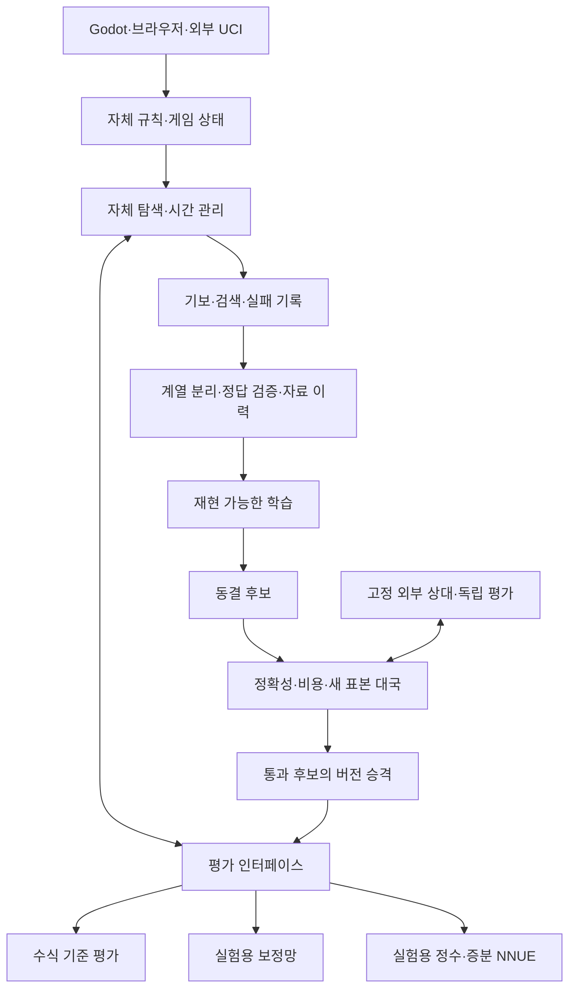

# Regicide 현황·블루프린트·개발 로드맵

작성일: 2026-10-17  
갱신일: 2026-10-21, 한국 시간

**Regicide는 자체 규칙·탐색으로 대국하고, 자체 자료로 신경망을 학습·평가하는 연구 기반을 갖췄다. 다음 핵심 성과는 새 변경 하나의 실제 경기력 향상을 재현하고, 외부 상대군에서 현재 실력의 기준점을 확보하는 것이다.**

세계 최고 엔진이라는 목표를 유지한다. 현재는 세계 순위·외부 평가 집단의 Elo·목표 달성 시점을 산정할 근거가 부족하다. 아래 현황은 소스와 보관된 실행 기록을 확인한 결과이며, 신규 마일스톤은 앞으로의 계획이다. 원본 현황 표의 수치는 각 연구 당시 기록이며, 이번 통합 후 새로 실행한 기능·학습 연결 검증은 M1 통합 기록을 따른다.

## M1 통합 진행 결과

2026-10-21에 두 경로를 연결한 `0.7.0-dev` 개발본을 만들었다. **M1의 로컬 엔진 통합은 완료**했다. 설치본의 수식 평가·보정망·자동 학습과 연구의 정수·증분 NNUE·QAT를 하나의 엔진에서 명시적으로 선택한다. 모델 형식과 기존 학습 체계는 각각 보존한다. 통합 설계·검증 결과와 재현 방법은 [M1 통합 기록](M1_INTEGRATION.md)을 따른다. 아래 두 경로 표는 통합에 사용한 원본의 계보다.

## 1. 현재 위치: 두 개발 경로

2026-10-21에 작업·설치 체크아웃과 원격 브랜치를 확인했다. 버전 번호만으로 프로젝트 전체 진전이나 가장 강한 엔진을 판단할 수 없다.

| 경로 | 확인한 기준점 | 확보한 것 |
| --- | --- | --- |
| 현재 NNUE 연구 | `experiment/see-cost-improvement`, `0f7783bf8212b86be0fbd74e425c55c4ffc61a06`, CMake v0.5.3 | 자체 정수 신경망·증분 평가·QAT·정밀도 개선·정적/탐색 정답 비교·10/21 원인 진단 |
| 설치·자동 학습 경로 | `C:/Users/hanso/dev/Regicide`, `desktop/endgame-learning-scale`, `3c3d4b4526e1fa0c927347d9974534e4385ea601`, v0.6.5 | 폰 방패·폰 구조 평가·보수적 LMR·실수 보정망·자동 수집/재학습/조건부 채택·종반 자료 연구와 원격 검증 |
| 원격 기본 브랜치 | 확인 시 `main`은 `e3b0902a3e9203f63725f19eda562af6cce2d5fe` | README는 초기화 단계로 서술하며 루트 CMake 파일을 확인하지 못함. 기본 브랜치 문서와 실제 개발 경로의 불일치 정리 필요 |

설치 경로에는 생각 시간 표시 등 미커밋 변경이 있다. 필요한 변경을 통합 폴더에 복사했으며 원본 작업 폴더와 개인 기보는 수정하지 않았다. 현재 통합 기준의 소스·실행 파일·대표 모델·옵션 연결은 [M1 정리 기록](M1_INTEGRATION.md)과 [M2 동결 프로필·검증 기록](checks/2026-10-21-m2-foundation/README.md)을 따른다.

### 두 신경망은 다른 설계다

| 항목 | 정수·증분 NNUE 연구 | 설치 경로의 V2 보정망 |
| --- | --- | --- |
| 구조 | 768입력×16은닉, 백·흑 공유 관점, S32 정수 모델 | 768→32→16→1 실수 모델 |
| 역할 | 학습된 위치 평가를 실험적으로 선택 | 기존 수식 평가에 최대 ±100cp 보정 |
| 계산 | 수마다 바뀐 기물의 누산값만 갱신. 전체 재계산을 검증 기준으로 유지 | 희소 입력 추론·메모리 배치 최적화. 이 경로에는 증분 누산·정수 QAT 미연결 |
| 손번 | 현재 입력에 손번 정보가 없어 표현 제약 확인 | 누가 둘 차례인지에 따라 자기/상대 채널과 칸 방향 변경 |
| 실전 상태 | 같은 시간의 고전 평가 대비 우위 미입증 | 후보 미채택, 기본 수식 평가 유지 |

연구망의 손번 누락을 설치 보정망의 동일한 결함으로 해석하지 않는다. 설치본의 자동 학습 순환도 정수 NNUE까지 통합됐다는 뜻은 아니다.

## 2. 확보한 기반과 실제 성과

| 분야 | 확보한 것 | 남은 문제 |
| --- | --- | --- |
| 규칙 | FEN·합법 수·킹 안전·특수 수·make/undo·메이트·반복·수 카운터 처리 | 복잡한 죽은 포지션의 일반 판정. FEN만으로 과거 반복 이력 복원 불가 |
| 탐색 | 자체 negamax/alpha-beta·반복 심화·PVS·안정화 탐색·전이표·killer/history·SEE | 조용한 위협·깊이 배분·시간 관리. 현재 단일 탐색 스레드 |
| 추가 평가·탐색 | 설치 경로의 폰 방패·통과/고립/겹친 폰·보수적 LMR | 일반적 강도 이득 미확정. 첫 도입 과제로 중복 계획하지 않음 |
| 학습 | 자체 자료·계열 분리·교사 검색/정제·학습·저장/로드·후보 검증 | 자료량·모방 오차 개선과 실전 개선의 연결이 약함 |
| 대국 | UCI·Godot/브라우저·무르기·핸디캡·기보 보관/재생 | 대회 수준 전체 시계 심판·독립 평가 확장 |
| 검증 | perft·특수 규칙·상태 복원·외부 기준 2,997사례·회귀·기보/PV 감사·해시·CI 기록 | 버전별 증거 연결·외부 실력 기준선·작은 향상을 검출할 표본과 예산 |

최근 핵심 결과는 다음과 같다. 득점률은 `(승 + 무승부/2) / 판수`이며, 조건이 다른 결과를 합쳐 전체 기력으로 해석하지 않는다.

| 실험 | 기록된 결과 | 현재 판단 |
| --- | --- | --- |
| 정수 NNUE 증분 평가 | 전체 재계산·특수 수·undo 일치, 깊이4 탐색50쌍 일치. 해당 엔진 보고시간 약15% 감소 | 정확성과 해당 작업 비용의 성과 |
| S32 정밀도 QAT | 새64게임·1,893위치에서 정적 교사 모방 MAE 30.62→11.21cp | 배포 정밀도 개선. 강도는 별도 |
| 위 모델 대 고전 평가 | 100ms 16판 2승2무12패; 1초 16판 5승4무7패 | 같은 시간의 우위 미확인 |
| 정적 정답 A 대 자체10k 탐색 정답 B | 학습2,209·검증723·보류687, 여섯 모델. B는 A 상대100ms 96판 27승20무49패, 38.54% | B 확대 기준 미통과. A가 고전보다 강하다는 뜻도 아님 |
| 설치 V2·교사 정제 후보 | 각각64판 11승18무35패, 18승12무34패 | 둘 다 미채택 |
| 설치 v0.6.4 추론 최적화 | 정적 호출 약24%, 고정10k노드 탐색 약4~5% 단축, 작업720쌍 일치 | 비용 개선. 강도 향상 실험은 아님 |
| 설치 v0.6.5 종반 규모 연구 | 새 학습 정답1,314·종반 보류130. 자료량 효과 불일관; 원격16판 2승5무9패 후 사전 탈락 기준 도달 | 기존 수식 평가 유지 |
| 설치 LMR 재대국 | 200ms 16판 4승7무5패 | 이 소표본에서 강도 개선 미확인 |

10/21 NNUE 진단은 소수의 큰 정답 차이 집단에 최종 제곱오차가 집중되고, 보통 위치의 오차가 악화된 현상과 손번 표현 제약을 확인했다. 원인별 패배 기여율은 미확정이다. 후속 Huber의 기존6모델 재현·새6모델 준비와 native 검증은 [완료](checks/2026-10-21-m3-huber-preparation/README.md)했으며, 새 확인 자료와 기력 비교는 실행 전이다.

## 3. 목표와 성공 기준

최종 목표는 **자체 Regicide가 공개적으로 비교 가능한 조건에서 세계 최고 엔진들과 경쟁하고, 반복 검증으로 최고 성능을 입증하는 것**이다.

- 인간 정상급 상대 도전과 엔진 정상급 경쟁을 별도 이정표로 관리한다. 엔진 Elo·약화 옵션을 인간 FIDE Elo로 환산하지 않는다.
- 상대 버전·모델, 하드웨어, CPU/GPU 자원·스레드·Hash, 시간제어, 개시군, 선후공과 자료 허용 조건을 공개한다.
- 특정 환경의 1위, 특정 상대 우위, 여러 독립 평가의 최고권 성적을 구분한다.
- 내부 비교 → 외부 상대군 → 강한 상대와 장시간 재현 → 독립 운영 대회·평가로 증거를 넓힌다.
- 사용자가 변경의 원리·실패 조건·검증 결과를 설명할 수 있는 상태를 각 단계의 학습 성과로 남긴다.

현재 결과로 세계 최고까지 남은 기간이나 격차 수치를 추정하지 않는다. 아래 완료 기준을 차례로 충족하며 일정과 자원 계획을 갱신한다.

## 4. 블루프린트

현재 권고는 **CPU 기반 자체 탐색을 중심에 두고, 평가·자료·검증을 교체 가능한 구조로 연결하는 것**이다. 규칙·탐색·세 평가 모드와 양쪽 학습 도구의 공존은 M1에서 구현했다. 아래 구조 중 각 계열의 자료·학습 경로는 별도로 유지하며, 강도 승격과 외부 성적 검증은 후속 단계다.

| 구성 | 핵심 설계 원칙 |
| --- | --- |
| 규칙·상태 | 보드와 전체 이력을 단일 기준으로 두고 평가 캐시·중단·undo의 경계를 검증 |
| 탐색 | 정확한 기본 경로와 실험 옵션을 비교 가능하게 유지. 이미 있는 LMR의 효과도 재검증 |
| 평가 | 수식·보정망·NNUE의 입력 상태·손번·점수 관점·단위·모델 형식·증분 갱신 계약을 명시 |
| 자료·학습 | 출처·부모 계열·전체 수순·교사 예산·시드 보존. 루트/말단 분포·교사 오차·손실·표현을 분리 검증 |
| 승격 | 결과 확인 전 후보·기준·중단 정책 고정. 내부 개선을 공통 기준판과 외부 상대에서 재검증 |

작은 체스 예로 보면, 같은 배치라도 내가 먼저 두면 상대 승격을 막고 상대가 먼저 두면 퀸이 생길 수 있다. 평가 입력이 이 차이를 구분해야 한다. 탐색은 그 평가를 사용해 수를 고르므로, 입력 표현·검색 예산·실제 수 선택을 함께 검증해야 한다.

| 기술 경로 | 장점 | 비용·권고 |
| --- | --- | --- |
| 자체 alpha-beta + 수식/NNUE | 기존 코드·검증을 이어 쓰며 작은 변경의 효과를 분리하기 쉬움 | 현재 주 경로. 학습 평가와 선택 탐색의 실전 이득을 먼저 확인 |
| 신경망 + MCTS·자기대국 강화학습 | 정책·가치 학습과 다른 탐색 결합을 연구 가능 | 자료 생성·추론 배치·학습 순환·GPU 비용을 별도 설계. 비교 연구 후보로 유지 |

Stockfish 공식 자료는 alpha-beta·NNUE와 대국 검증을, Lc0는 신경망·MCTS와 자기대국 학습 인프라를 설명한다. 이는 접근법의 참고 자료이며 Regicide의 성능 보장은 아니다. [Stockfish](https://stockfishchess.org/), [Fishtest](https://github.com/official-stockfish/fishtest), [Lc0 공식 개요](https://lczero.org/dev/overview/). 확인일: 2026-10-21.

## 5. 로드맵과 마일스톤

M0은 확보한 기반, M1은 완료한 로컬 통합이다. M2 이후는 다음 완료 기준이며, M2와 M3의 준비는 병행할 수 있다.

| 단계 | 만들 결과 | 완료 기준 |
| --- | --- | --- |
| M0 자체 엔진·연구 기반 | 규칙·탐색·대국·회귀·학습 실험 | 확보. 알려진 규칙 한계와 강도 미확정은 계속 명시 |
| M1 두 경로의 성과 통합 | 운영·NNUE의 기능/모델/증거 지도와 공통 비교 기반 | **로컬 완료.** 두 계열 공존·56원본쌍·23UCI·양계열 학습·원본 보존 검증. 기준판·바로가기·기본 브랜치 반영 대상은 M1 문서에 명시. 원격 반영은 별도 배포 과제 |
| M2 외부 실력 기준선 | 여러 강도의 고정 외부 상대와 시간별 성적표 | **사용자가 축소한 빠른 기준선 96판 완료.** 사전24판·본96판 모두 제품/독립 감사 PASS. 본19분14.5초, 오류·미완료0. 20% 잔여 부하는 경고만 기록하며 실제 엔진 CPU/응답과 소속을 검증했다. 조건당8판의 설명용 결과이며 승격/Elo 근거는 아니다. [성적·검증 기록](experiments/2026-10-21-m2-baseline96-outcome.md) |
| M3 첫 재현 가능한 강화 | 탐색 또는 학습 후보 하나의 실전 이득 | **Huber 손실 단독16판 비교 완료, 강화는 미입증.** 같은 B자료·구조·초기값·시드의 준비된 MSE/H100을 재학습 없이 비교해 H1004승7무5패(2분6초), 독립 감사PASS. 이전 실용 비교3승7무6패와 합산하지 않고 모델 교체/판수 확대 없이 보존한다. [조건 통제 결과](experiments/2026-10-21-m3-huber-loss-only.md), [이전 실용 비교](experiments/2026-10-21-m3-huber-screen.md) |
| M4 학습·탐색 확대 | 더 나은 입력·정답·실전 말단 자료·효율적 추론/탐색 | 한 요인씩 효과 분리. 같은 노드 판단과 같은 시간 성적 별도 보고. 자료량·생성/학습 시간·모델 크기 대비 이득 곡선 확보 |
| M5 강한 자체 엔진 | 검증된 평가·선택 탐색·시간 관리, 필요시 SIMD/비트보드/병렬화 | 여러 상대·개시군·중장시간·다른 환경에서 개선 재현. 장시간 안정성·정식 시계·공개 재현 패키지 확보 |
| M6 세계 최고권 경쟁 | 공개 버전과 독립 운영 대국·평가 | 당시 최고권 엔진의 고정 버전과 조건으로 경쟁력 확인. 세계 최고 주장은 독립 평가의 실제 성적과 적용 범위로 입증 |

인간 정상급 도전은 외부 실력·전체 시계·안정성 검증을 갖춘 뒤 별도 대국 조건을 마련한다. M6의 엔진 최고권 검증을 인간 상대 성적으로 대신하지 않는다.

## 6. 바로 다음 개발 순서

### 우선: 기준판 정리와 외부 평가

1. M1 통합판의 수식 평가를 공통 운영 기준으로 고정한다. 보정망 V2와 정수 NNUE S32는 M1에서 쓴 대표 모델을 유지하며 각각의 프로필로 비교한다. 세 프로필의 모델·실행 파일·옵션·학습 출처를 동결하고 바뀐 입력은 거절한다.
2. 기존 외부 UCI 도구를 재사용해 사전 계획 동결·후보 순서 회전·시간 상한·원시 기보/JSON 독립 재생을 연결한다. 별도 경로의 기준판이나 모델을 조용히 바꾸지 않는다.
3. 공식 고정 Stockfish 18과 Sunfish 커밋을 비교용 상대에 사용한다. 실제 수를 고르는 Regicide의 핵심 엔진에는 이들 코드를 연결하지 않는다. 출처·라이선스·실행 파일 및 해석기/스크립트 해시는 M2 기록을 따른다.
4. 2개 개시 계열·양색·50/200ms·세 프로필·두 상대의 **48판 파일럿을 완료**했다. [실제 성적과 독립 감사](checks/2026-10-21-m2-foundation/README.md)를 보존했다. 공유 PC에서 외부 엔진의 연산도 관측돼 강도 승격·Elo·M2 전체 완료 근거로 사용하지 않는다. 사용한 두 계열은 이후 개발 자료로 취급한다.
5. 사용자가 비교 비용을 줄이도록 지시해 본 목표를768판에서96판으로 축소했다. 기존 은행의 첫4개시·양색·100ms/1초·세 평가 방식·두 상대를 고정해 모두 완료했다. 조건당8판의 현황 파악이며 파일럿·사전·과거 중단 성적과 합치지 않는다. 더 넓은 정밀 비교는 필요할 때 목적·예상 비용을 먼저 설명한다.

이전 CPU 계측 단계의 기록: 실험 Job, 진행·감시 프로그램, 잔여 시스템 부하를 분리했다. 실제 Windows 부하 검증과 원시 기록 독립 재계산이 통과했으나 당시 사전 대국이16/24판, 수정 뒤12/24판에서 각각 부하 기준으로 중단됐다. 이는 특정 사용자 앱을 켰다는 증거가 아니다. 그 무효 성적과 M3 Huber 준비는 보존한다. [이전 결과](experiments/2026-10-21-m2-job-accounting-outcome.md)는 현재 최종 상태와 구분한다.

이전768판 계획·사전24판·코어 배분은 [당시 실행 기록](checks/2026-10-21-m2-formal/README.md)에 남긴다. 당시 본176판은 잔여 부하 상한으로 중단됐고, 이후 본40판·194판은 감시 코드의 부모 PID 오인으로 중단됐다. 이 부분 성적들은 무효로 보존한다. 최종 v6는 명시적 소유 Job을 먼저 확인하고20%는 경고만 기록한다. 새 사전24판 통과 후 사용자 선택의96판을 완주했으며 신경망의 우위는 미입증이라 기본 수식 평가를 유지한다. 앞으로는 **학습·엔진 코드 개발을 우선하고, 변경 하나를 짧은16판부터 비교**하는 [실험 원칙](EXPERIMENT_POLICY.md)을 따른다.

### 학습 연구 후보: NNUE 손실 함수

현 연구에는 [정답 A/B × 손실 MSE/Huber의 2×2 후속 제안](experiments/2026-10-21-neural-target-ab-diagnosis.md)이 있다. Huber는 큰 오차의 영향을 선형으로 제한한다. 소수 큰 오차를 줄이는 과정에서 보통 위치가 악화됐다는 가설을 확인한다.

- 같은 자료·망·학습량·학습률에서 세 배치 순서씩12모델. 기존 MSE 조건의 재현을 먼저 확인한다.
- 새 계열의 공통100k 참조 오차와 후보 수 선택을 확인한다. 참조 검색은 완전한 정답이 아니다.
- 첫192판은 B-Huber 대 B-MSE다. 계획 기준을 통과하면 별도 새192판에서 A-MSE와 비교한다. 블록별 상한45분이며 준비·검증 시간은 별도다.
- 이 성공만으로 고전 평가 우위를 주장하지 않는다. 공통 기준판에서 수식 평가·외부 상대 검증이 추가로 필요하다.
- 기존 보류687행과96판은 원인 분석에 사용했으므로 다음 확인 표본으로 재사용하지 않는다.

이 실험은 정수 연구망의 원인 분리 과제다. 설치 보정망에 자동 적용하지 않는다. 이후 입력 학습률·학습량·손번·교사 예산·말단 분포·너비를 한 요인씩 검토한다.

### 탐색 연구 후보: 비용과 패배 연결

SEE 비용 실험의 한 표본에서 안정화 노드가 전체 노드의92.193%였다. 이는 실행시간·낭비 비중이 아니다. 공통 기준판에서 체크 회피·수 생성·정렬·평가·메모리 비용을 새로 분해하고 실제 패배의 조용한 위협을 재현한다.

LMR은 이미 구현돼 있다. 보호 조건·수 순서·시간별 효과를 검증하며, aspiration window·null-move·futility/delta 등 다른 기법은 해결할 병목을 확인한 뒤 하나씩 검토한다. 가지를 줄이는 변경은 기존 탐색과 점수 일치만을 요구하지 않고 정확한 기본 경로·전술 회귀·종반 반례·같은 시간 대국으로 평가한다.

## 7. 검증·자원·연속성

- 규칙·상태: perft·특수 수·반복·무승부·중단·undo 회귀를 유지한다.
- 같은 의미의 최적화: 약속한 점수·선택·탐색 동작 일치와 실제 작업 비용을 확인한다.
- 모델: 전체 재계산 대조, 저장/로드·범위·관점·단위·특수 수·undo·취소를 확인한다.
- 학습: 부모 계열 분리·대칭 입력 중복 검사·새 확인 자료·시드·교사·모델 동결을 유지한다.
- 강도: 상대·시간별 새 선후공 대국과 계열 단위 불확실성, 오류·무효·미완료·중단 이유를 보존한다.
- 승격: 후보·표본 수·중단 규칙을 사전 고정하고 별도 재현·독립 감사·설치/원격 해시를 연결한다.

설치 경로의 승격 검정은 반복 시도의 오류 예산을 나누는 보수적 구조다. 작은 향상을 찾는 데 필요한 대국 수와 검출력을 별도로 설계할 필요가 있다. 기존 실패 결과의 기준을 보존하고 다음 실험 전에 고정 판수/순차 검정의 가설·오판 예산·색 교환 쌍 처리·상한을 검토한다. 엄격한 기준이 이번 후보의 실제 열세를 설명한다는 근거는 없다.

현재 PC에서 Ryzen AI 7 350(8코어/16논리), RAM 약32GB, RTX 5070 Ti Laptop GPU를 확인했다. 현재 탐색은 단일 스레드이며 GPU가 자동 활용되지는 않는다. 작은 비교부터 시작하고 자료 생성·학습·추론·대국의 처리량을 각각 잰 뒤 규모와 병렬화를 정한다. 주당 가용 시간·연산 예산·원격 환경의 현재 가용성·GPU 학습 환경은 계획 변수다.

대규모 자기대국·큰 망·보드 표현 전면 교체·병렬 탐색은 해결할 병목과 비용 대비 이득을 확인해 선택한다. 실패한 후보도 소스·자료·모델·원시 대국·감사와 함께 남긴다.

## 8. 근거와 정리할 문서

- 현재 연구: [증분 평가](NEURAL_INCREMENTAL.md), [정밀도](NEURAL_PRECISION.md), [강도 비교](experiments/2026-10-19-neural-strength.md), [정답 A/B](experiments/2026-10-20-neural-target-ab.md), [10/21 진단](experiments/2026-10-21-neural-target-ab-diagnosis.md).
- 설치 경로 고정 소스: [v0.6.5 README](https://github.com/bigpine-choi/Regicide/blob/3c3d4b4526e1fa0c927347d9974534e4385ea601/README.md), [자동 학습·채택](https://github.com/bigpine-choi/Regicide/blob/3c3d4b4526e1fa0c927347d9974534e4385ea601/docs/CONTINUAL_LEARNING.md), [종반 규모·검증·설치](https://github.com/bigpine-choi/Regicide/blob/3c3d4b4526e1fa0c927347d9974534e4385ea601/docs/checks/2026-10-19-endgame-learning-scale/README.md), [외부 UCI 도구](https://github.com/bigpine-choi/Regicide/blob/3c3d4b4526e1fa0c927347d9974534e4385ea601/docs/EXTERNAL_BASELINE.md).
- 외부 설계 참고: [공식 NNUE 설명](https://github.com/official-stockfish/nnue-pytorch/blob/master/docs/nnue.md), [Fishtest](https://github.com/official-stockfish/fishtest), [Lc0 개요](https://lczero.org/dev/overview/). 확인일2026-10-21. 기술 권고는 Regicide를 위한 판단이며 외부 자료의 성능 보장이 아니다.

설치 경로의 ROADMAP·HUMAN_TOP_LEVEL_PLAN은 과거 원본으로 보존한다. 현재 진행 기준은 이 통합 체크아웃의 문서이며, 기본 브랜치 반영 대상과 아직 실행하지 않은 원격 배포는 [M1 정리 기록](M1_INTEGRATION.md#로컬-통합-완료와-배포-경계)에 구분한다.

## 부록: 2026-10-18 당시 로드맵 원문

아래는 초기 개발 순서와 당시 판단을 보존한 기록이다. 현재 상태·향후 우선순위는 위 2026-10-21 계획을 따른다. 아래 v1.0의 인간 도전 목표는 최종 엔진 최고권 목표와 별도다.

상태: v0.5.3 후보는 [1초 패배 분석과 SEE 계산 비용 최적화](experiments/2026-10-18-see-cost.md)를 완료했다. 교환 값과 수 순서·기존 규칙을 유지했고 함수 비용은 감소했지만 전체 탐색 시간 차이는 작고 혼재됐다. 수정 전 SEE v0.5.2와 새 위치·외부 CPU 증가 0의 비교는 100ms 5승 3무 8패, 1초 5승 7무 4패여서 일관된 경기력 개선은 미확정이다. 이전 결과와 원자료를 보존하고 안정판 승격은 보류한다. 안정화 탐색·조용한 위협의 원인 분석, 복잡한 죽은 포지션의 일반 판정, 더 넓은 보류 표본·강한 외부 상대와 학습은 남아 있다.

### 2026-10-18 현재 진행

- [x] 초기 합법 수 20개, FEN 입출력, 수 적용·되돌리기.
- [x] 킹 안전성을 반영한 이동, 캐슬링·앙파상·4종 승격.
- [x] 6개 기준 포지션 perft 및 특수 규칙·전체 상태 복원 검증.
- [x] 체크메이트·스테일메이트, 반복/수 카운터 및 청구·자동 무승부 구분.
- [x] Windows 빌드와 Linux AddressSanitizer/UndefinedBehaviorSanitizer 검증, Python 외부 기준과 교차 검증.
- [ ] 복잡한 죽은 포지션의 일반 판정. 현재는 확실한 기물 구성의 일부만 탐지.
- [x] v0.2 기물 가치 평가·자체 alpha-beta 탐색·기본 시간 관리·UCI 연결.
- [x] 외부 UCI 클라이언트를 통한 자기대국 완주 및 PGN/JSON 수순·종료 재검증.
- [x] v0.3 자체 위치 평가·안정화 탐색과 이전 버전 대비 같은 조건의 선후공 교대 비교.
- [x] v0.4 실제 병목 프로파일링·검색 비용 최적화·이력을 구분하는 전이표와 같은 시간 대국 비교.
- [x] v0.4.1 전이표 메모리 재사용, 옵션·이력·세대 순환 검증과 최초/반복 검색 비용 분리 측정.
- [x] v0.5.0 패배 기보 분석과 제한된 체크 연장·일반 수 정렬, 사전 고정한 새 시작 위치의 100ms 비교.
- [x] 최신 자체 엔진과의 Godot 연습 대국, 플레이어 색과 독립적인 백·흑 시점 전환 및 자동 입력·실제 엔진 연결 검증. [실행 안내](GODOT_PLAY.md).
- [x] 무르기와 과거 Regicide 수의 합법 수 교체, 취소 복원·핸디캡 기보 구분 및 새 수순에서의 탐색 재시작.
- [x] 사용자 대국의 독립 보관함·기존 기록 가져오기·완료/미완료 구분과 현재 대국을 바꾸지 않는 기보 재생.
- [x] v0.5.1 PVS의 기존 탐색 점수 보존, 계산 비용 및 100ms·1초 각각 16판 선후공 교대 비교. [실험](experiments/2026-10-18-pvs.md): 비용은 감소했고 100ms 9승 4무 3패, 1초 6승 4무 6패. 일반적 경기력 향상과 안정판 교체는 보류.
- [x] v0.5.2 SEE를 수 정렬에만 적용, 음수 희생 수·규칙 검증 유지, [고정 깊이 비용·100ms·1초 각각 16판 비교와 독립 감사](experiments/2026-10-18-see.md). 비용 감소와 이 개발 표본의 우세를 관측했으며 일반적 강도와 안정판 교체는 추가 검증.
- [x] 엔진 코드를 고정하고 [새 시작 위치·외부 CPU 증가 0에서 시간별 16판 재현 비교](experiments/2026-10-18-see-replication.md). 100ms는 우세, 1초는 열세여서 일관된 경기력 개선은 미확인. 중단 원본·채택 정책·규칙 재검증·독립 감사를 보존.
- [ ] 강한 외부 상대·다양한 보류 포지션에서 경기력 검증, 속도 비용 및 다음 최적화 평가.
- [x] v0.5.3의 1초 패배 7판 분석·SEE 동값 최적화, C++ 회귀 96그룹·50,531검사와 고정 깊이 125쌍 확인, [새 위치의 외부 CPU 증가 0에서 100ms·1초 비교](experiments/2026-10-18-see-cost.md). 함수 비용 감소와 혼재된 전체 시간, 100ms 열세·1초 소폭 우세를 구분해 보존.

재현 방법과 검증 수치는 [규칙 코어 문서](RULES_CORE.md), [첫 대국 엔진](ENGINE.md) 및 `experiments/`의 실행 기록에 남긴다. 아래 기술 방향 중 학습 방식·최종 엔진 구조는 계속 검토 사항이다.

v0.2에서는 중단 시 마지막으로 완료한 탐색 결과를 반환하기 위해 반복 심화를 먼저 도입했다. v0.3에서는 캡처 연쇄 도중의 평가를 안정화 탐색으로 보완하고 위치 점수를 더했다. 8개 고정 시작 포지션의 선후공 교대 16판에서 1,000노드 조건 13승 3무, 40ms 조건 10승 5무 1패를 기록했다. 위치 평가만/안정화만의 비교와 시간 비용을 포함한 [실험 기록](experiments/2026-10-17-position-quiescence.md)을 기준으로 다음 가설을 정한다. 이 결과를 Elo나 강한 외부 엔진 상대 성능으로 환산하지 않는다.

v0.4는 합법 수 중복 검증·반복 상태 문자열 비용을 줄이고 탐색 결과를 재사용한다. 고정 표본의 전이표 단독 깊이 4 비교는 중앙 1.60배 가속, 이전 v0.3과 40ms/수 15승 1무, 100ms/수 15승 1패였다. [실측 비용·32판 결과](experiments/2026-10-17-profile-transposition.md)에 느려진 위치와 표 초기화 한계도 남겼다. 다음 가설은 메모리 재사용 비용 절감 및 보류 표본·강한 상대에서의 효과다.

v0.4.1은 같은 메모리를 재사용하며 이전 검색 기록을 세대로 무효화한다. 준비 후 깊이 1/3의 중앙 가속은 각각 3.72/1.37배였고, 기존 버전과 250쌍의 수·점수·탐색 동작이 같았다. [실험 기록](experiments/2026-10-17-hash-memory.md)에서 최초 할당·반복 검색·같은 시간 대국을 나누어 해석한다. 이후 가설은 검색 자체의 질을 높이는 방법과 보류 표본·강한 상대에서의 검증이다.

v0.5.0은 패배 분석에서 조용한 체크 연쇄와 얕은 일반 탐색의 약점을 확인했다. 100ms/수에서 사전 고정한 새 16판은 10승 3무 3패, 기존 개발 16판은 4승 4무 8패였다. 표본별 결과가 반대여서 일반적인 우위를 확정하지 않는다. [사전 계획](experiments/2026-10-17-loss-guided-plan.md)을 구현 전에 고정하고, [실행 기록](experiments/2026-10-17-loss-guided.md)에 개발 위치 변화와 같은 시간 대국을 별도로 기록한다.

## 1. 목표

자체 체스 엔진을 개발해 세계 최정상급 인간 선수를 이길 수 있는 경기력에 도전한다.

- 표준 체스에서 시간 제한, 하드웨어, 사용 가능한 자료와 대국 조건을 명시한다.
- 단일 대국의 승리와 반복 대국에서 확인한 실력의 우위를 구분한다.
- 최강 인간 선수에게 이기는 목표와 세계 최강 엔진과 경쟁하는 목표는 별도 이정표로 관리한다.
- 엔진끼리 산정한 Elo를 인간의 FIDE Elo와 직접 환산하지 않는다.
- 최종 성능은 독립적인 평가와 충분한 대국 결과로 검증한다. 현재 도달 시점과 승률은 추정하지 않는다.

## 2. 권고하는 개발 방향

자체 규칙 처리 → 탐색과 간단한 평가 → 측정 가능한 탐색 개선 → 필요에 따른 자체 신경망 평가 → 독립 검증 순서로 진행한다.

첫 경로로는 CPU에서 실행하는 탐색 기반 엔진을 권고한다. 작은 단위로 정확성을 확인하고 기준 엔진을 확보해, 이후 평가 함수나 학습 기법의 효과를 비교하기 위한 선택이다. 최종 구조는 실험 결과에 따라 변경할 수 있다.

자기대국 강화학습은 별도 기술 선택 사항이다. 이 경로에는 규칙·탐색 구현 외에 대국 데이터 생성, 모델 학습, 평가와 추론 처리까지 필요하므로 사용 가능한 연산 자원과 비용을 확인한 뒤 범위를 정한다.

첫 기준 구현은 핵심 엔진에 C++20, 검증 도구에 Python을 사용한다. Windows MSVC와 Linux GCC로 검증한다. 장기적인 최적화·학습 구조는 실험 결과와 학습 부담을 확인해 결정한다.

## 3. 단계별 이정표

| 단계 | 구현 범위 | 완료 기준 |
| --- | --- | --- |
| M0: 개발 기반 | 빌드 방법, 자동 검증 실행 방법, 기록 체계 | 정한 개발 환경에서 문서대로 빌드·실행·검증을 재현 |
| v0.1: 규칙 코어 | 보드와 기물, FEN 입력·출력, 합법 수 생성, 수 적용·되돌리기, 특수 수와 종료 판정에 필요한 상태 | 기준 포지션의 수 생성 검증 및 상태 복원 검증 통과 |
| v0.2: 첫 자체 대국 엔진 | 간단한 평가 함수, negamax/alpha-beta 탐색, UCI 입출력, 기본 시간 관리 | 기존 GUI 또는 대국 실행 도구와 연결해 불법 수·크래시 없이 대국을 완주하고 기보 저장 |
| v0.3: 측정 가능한 강화 | 반복 심화, 수 정렬, 안정화 탐색, 탐색 결과 캐시 등 | 변경별로 정확성과 실행 성능을 확인하고 통제된 대국에서 개선 효과 평가 |
| v0.4: 병목과 탐색 재사용 | 프로파일링 기반 최적화·전이표·이력 안전성 | 규칙·점수 일치 유지, 같은 깊이 비용과 같은 시간 대국 성적을 별도로 측정 |
| v0.5: 패배 기반 탐색 개선 | 비캡처 체크 제한 연장·일반 수 정렬 | 패배 사례 회귀 검사와 기존/새 시작 위치의 같은 시간 비교 |
| v0.6 이후: 학습과 고성능화 | 데이터 생성, 자체 신경망 평가 또는 자기대국 학습 연구 | 학습·검증 데이터를 구분하고 기존 기준 엔진과 비용 대비 성능 비교 |
| v1.0: 인간 최정상 도전 검증 | 버전 고정, 외부 평가, 목표 상대와의 대국 조건 마련 | 실제 대국 결과와 독립 평가를 제시하고 주장 범위와 불확실성 명시 |

버전 번호는 개발 이정표용이며, 특정 Elo나 일정 달성을 보장하지 않는다.

## 4. 첫 구현 과제: v0.1 규칙 코어

### 첫 실행 결과

초기 체스 배치를 읽고 합법적인 첫 수 20개를 출력한다. 이후 여러 수를 적용하고 되돌렸을 때 전체 상태가 원래대로 복원되는지 확인한다. 이 결과만으로 규칙 코어 전체가 완성된 것으로 판단하지 않는다.

### 구현할 항목

- 기물·색·칸·수·게임 상태의 자료형.
- 초기 배치와 FEN의 입력·출력.
- 기물별 이동, 체크 상태와 킹 안전성을 반영한 합법 수 생성.
- 수 적용과 되돌리기 및 관련 상태 복원.
- 캐슬링, 앙파상, 프로모션.
- 체크메이트·스테일메이트와 무승부 판정에 필요한 상태 관리.
- 여러 기준 포지션을 이용한 perft 및 특수 규칙 검증.

perft는 일정 깊이까지 가능한 합법 수 경로의 수를 비교해 수 생성 구현을 점검하는 방법이다. 기물 이동의 정확성과 대국의 종료 판정은 각각 검증한다.

### 완료 기준

- 초기 배치의 합법 수 20개가 정확하다.
- 미리 선택한 여러 기준 포지션의 perft 결과가 기대값과 일치한다.
- 특수 수와 체크 관련 포지션 검증을 통과한다.
- 수 적용·되돌리기 후 기물 배치와 관련 게임 상태가 복원된다.
- 문서화한 명령으로 빌드와 검증을 재현한다.

## 5. 경기력 검증 원칙

- 각 실험에 코드 버전, 설정, 상대 버전, 하드웨어, 스레드·메모리 조건, 시간 제한과 대국 수를 기록한다.
- 시작 포지션을 통제하고 같은 포지션에서 선후공을 바꾸는 대국을 활용한다.
- 개발 중 조정에 사용한 문제·상대와 최종 검증 대상을 구분한다.
- 실행 속도, 전술 문제 정답률, 이전 버전 대비 대국 성적을 각각 보고한다.
- 제한된 상대나 적은 대국에서 나온 결과의 일반화 범위를 명시한다.
- 상용·기성 엔진은 비교와 검증 도구로 활용하고 실제 수 선택은 Regicide가 수행한다.

## 6. 다음에 확인할 정보

개발용 PC의 CPU·GPU·RAM, 주당 투입 가능한 시간, 학습용 연산 예산을 확인한다. 규칙 코어 개발은 GPU 학습 예산 결정 전에 진행할 수 있다.

## 7. 참고 자료

다음은 접근법을 검토하기 위한 1차 자료다. Regicide의 성능을 입증하는 자료는 아니다.

- [Stockfish 공식 저장소: UCI, NNUE 평가, 개발과 검증 안내](https://github.com/official-stockfish/Stockfish)
- [Stockfish 공식 탐색 구현](https://github.com/official-stockfish/Stockfish/blob/master/src/search.cpp)
- [Stockfish 개발자 문서](https://official-stockfish.github.io/docs/stockfish-wiki/Developers.html)
- [Leela Chess Zero 공식 개발 개요: 신경망·MCTS·자기대국 학습 구성](https://lczero.org/dev/overview/)
- [Silver 외, AlphaZero 원논문, 2017](https://arxiv.org/abs/1712.01815)

자료 확인일: 2026-10-17
