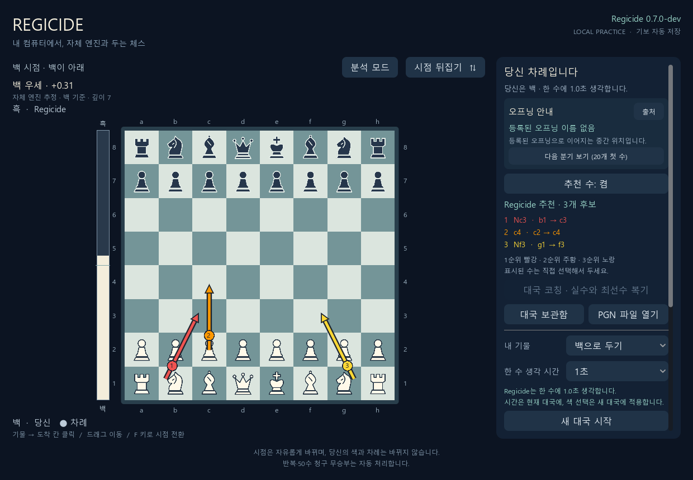
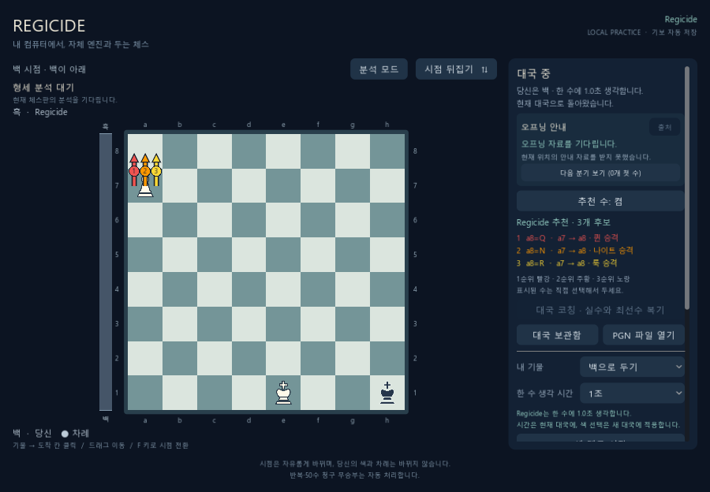

# 대국 중 세 후보 추천 검증 — 2026-11-02

기준 코드는 `b398ee29fb60080830c8bb9359c7087b64fd8aaf`이며 변경 파일 해시는 `source-manifest.json`에 기록한다. 소스 해시는 운영체제의 줄바꿈 차이를 제외하도록 CRLF를 LF로 정규화한 바이트 기준이다. Windows, Python 3.13, python-chess 1.11.2, Godot 4.7.2에서 확인했다. 실제 추천은 기존 Regicide 0.7.0-dev 실행 파일을 사용했으며 C++ 탐색·평가 코드와 실행 파일은 수정하지 않았다. 엔진 SHA-256은 `edd950fb673cfca4134968b64cc5ef0f3d77eda698e9f40d2965170f143d6e6a`다.

## 동작

- Godot·브라우저 대국 화면에서 최대 세 후보를 1순위 빨강 `#ef5350`, 2순위 주황 `#ff9800`, 3순위 노랑 `#fdd835` 화살표·숫자·수 이름으로 표시한다.
- 한 깊이에서 전체 루트 탐색, 첫 후보를 제외한 탐색, 앞의 두 후보를 제외한 탐색을 순서대로 수행한다. 각 후보는 같은 깊이를 완료한 정확한 점수와 합법 PV를 갖춰야 한다. 현재 둘 차례의 점수로 정렬하며 동점은 UCI 문자열 순서다. 메이트 거리는 점수 객체의 비교 규칙으로 처리한다.
- 한 라운드를 모두 마친 결과만 보관하고 더 깊은 라운드가 중단되면 직전 결과를 사용한다. 제한 시간은 전체 추천 작업이 공유한다. 첫 비교도 끝나지 않으면 임의의 추천을 만들지 않는다.
- 추천 응답에 `candidates` 배열을 추가하고 기존 최상위 `move`·`san` 등은 첫 후보와 일치시킨다. 끄기·국면 변경·모드 변경·대국 종료 때 후보를 모두 지운다. 화면은 현재 대국 ID·revision·FEN·합법 수와 순위를 검사한다.
- 기존 실시간 형세와 분석 모드의 단일 탐색은 유지한다. 제한된 후보 탐색 점수를 형세 막대에 게시하지 않는다. 사용자 대국·기보를 수정하지 않으며 별도의 임시 대국과 테스트 프로젝트로 검증했다.

## 실행한 검증

| 검사 | 결과 |
| --- | --- |
| `python tests/ranked_hint_tests.py` | 14개 통과: 동일 깊이, 점수·수순 근거, 흑 관점, 메이트·동점 순서, 시간 예산, 후속 후보 취소, 오래된 응답, 승격, 1·2개 합법 수, 스냅샷 복사 |
| `python tests/hint_state_tests.py build/regicide.exe` | 15개 통과: 실제 엔진, HTTP, 취소·재시도, 대국·기보·형세 보존 |
| `python tests/ranked_hint_real_tests.py build/regicide.exe` | 실제 엔진 7개 국면에서 합법성·고정 깊이 재계산 순위 일치·끄기 확인 |
| `python tests/analysis_evaluation_tests.py build/regicide.exe` | 16개 통과: 기존 분석 스트림, 실제 엔진 점수·취소 포함 |
| `python tests/human_play_tests.py build/regicide.exe` | 실시간 형세 21개 + 사람 대국 25개 통과 |
| `python tests/analysis_tests.py` | 21개 통과, 선택적인 실제 엔진 검사 1개 제외; 실제 분석 스트림 검사는 위 명령으로 별도 실행 |
| `python tests/opening_variety_tests.py` | 23개 통과 |
| `node tests/web_hint_tests.js` | 20개 통과: 세 화살표, 색상·번호, 승격·반전, 잘못된 응답, 직접 착수, 모드 전환 |
| 기존 웹 코칭·모션·분석·오프닝 | 각각 65·21·42·8개 통과, 생각 시간 검사도 통과 |
| Godot headless | 합성 입력 95개 + 실제 HTTP 37개 통과 |
| Godot 실제 렌더 | 합성 입력 102개 + 실제 HTTP 39개 통과 |

Godot 재현 명령은 `python tests/hint_godot_tests.py --godot GODOT --binary build/regicide.exe --rendered --output build/ranked-hints-native/rendered`다. 실행기는 프로젝트를 임시 폴더에 복사하고 별도의 설정과 대국 저장소를 사용한다. 렌더 창은 화면 밖에 생성하며 사용자의 실행 중인 게임을 종료하지 않는다. 합성 입력과 실제 렌더 검증이며 사람이 수동으로 대국한 결과라고 주장하지 않는다.

`real-results.json`에는 초기 백 국면(100ms·1초), 흑 국면, 앙파상 가능 국면, 승격, 합법 수가 1·2개뿐인 체크 회피의 결과를 저장했다. 각 후보 목록은 반환된 깊이에서 별도 UCI 탐색을 수행해 같은 순서가 재현되는지 확인했다. 앙파상 가능 국면이라는 이름은 그 국면에서 앙파상을 추천했다는 뜻은 아니다.

`native-layouts.json`에는 요청 창 크기 1240×860·900×680에서 대기·계산 중·1·2·3개 후보·긴 표기를 바꿨을 때의 보드 영역을 기록했다. 좌표는 Godot의 논리 캔버스 기준이며, 창 배율과 구분한다. 동일 창에서 후보 수와 문구가 바뀌어도 영역이 동일했다. `native-integration.json`에는 임시 HTTP 요청 경로와 저장 기보의 독립 재생 확인을 남겼다.

별도의 읽기 전용 코드 검토에서 완료 깊이·취소 경계·형세 격리·화면 초기화를 점검했고 수정이 필요한 문제를 발견하지 못했다. 실제 렌더 이미지의 작은 창과 뒤집힌 승격 후보도 확인했다. 이는 전체 결함 부재를 증명하는 결과는 아니다.

## 한계

이 검증은 추천의 근거·합법성·상태 격리·화면 동작을 확인한다. 외부 엔진과의 경기력 비교나 Elo 향상 증거가 아니다. 여러 후보가 기존 한 수 생각 시간을 나눠 사용하므로 단일 추천보다 완료 깊이가 낮아질 수 있다. 같은 깊이에서도 선택적 탐색의 근사 오차가 있으므로 표시 순위는 Regicide의 해당 검색 기준이다. 별도의 Stockfish나 온라인 AI 서비스는 사용하지 않았다.
