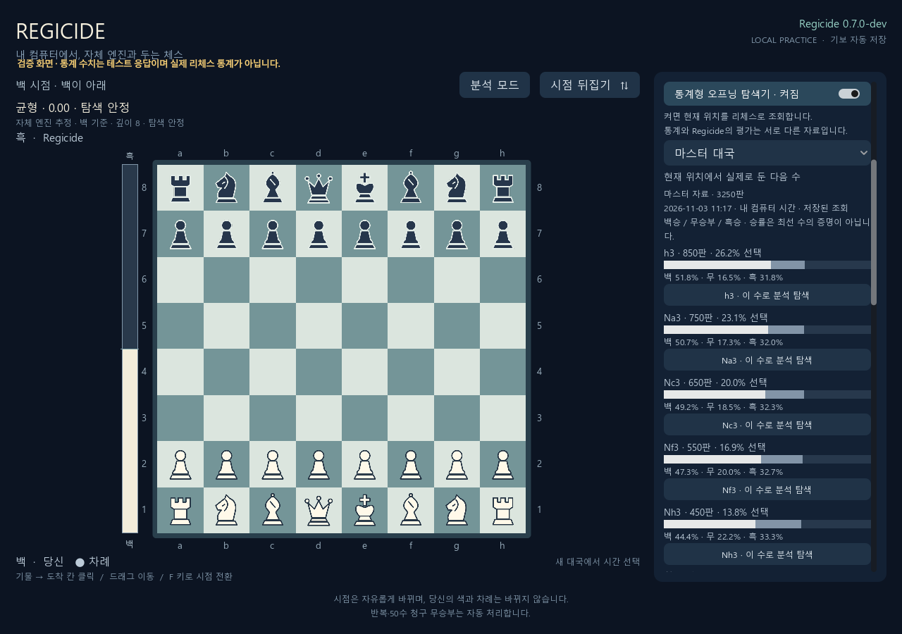
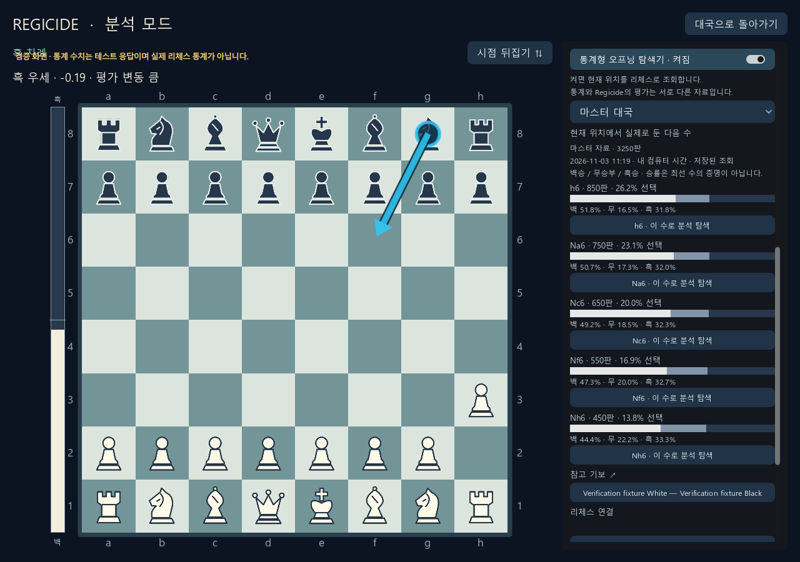

# 통계형 오프닝 탐색기 검증 — 2026-11-03

기준 커밋은 `470e304`, 구현 브랜치는 `feat/opening-explorer`입니다. 대국·분석 화면에서 마스터/일반 대국 통계를 조회하고, 선택한 다음 수를 별도 분석 보드에서 살펴보는 기능을 추가했습니다. 실제 수 선택과 분석 평가는 Regicide 자체 엔진을 사용합니다.

## 수행한 검증

| 검증 | 결과와 범위 |
| --- | --- |
| Python 탐색기·연결키 | 25개 통과. 응답 수치·합법 수·캐시·전치포지션·요청 직렬화·최신 요청·429·인증 실패·비밀 비노출·Windows 실제 DPAPI 왕복 |
| 로컬 HTTP | 6개 통과. 세션 인증·동일 출처·잘못된 요청·토큰 비반사·대국/기보 불변·정적 파일 제공 |
| 브라우저 탐색기 | 9개 통과. 기본 꺼짐·필터·늦은 응답·다른 조회·분기 분석·연결키·오류·안전한 링크 |
| 브라우저 회귀 | 분석 44개, 기존 오프닝 안내 12개 통과 |
| Godot 합성 UI | 26개 통과. 현재 위치·필터·저장 안내·마스터 링크·분석 진입 시 중복 조회 방지 |
| Godot 기존 UI 회귀 | 오프닝 안내 51개·분석 88개 통과 |
| 실제 HTTP + 실제 Regicide | 테스트 통계 응답을 사용해 별도 분석의 합법 추천 및 원래 대국·저장 파일 보존 확인 |
| 실제 Godot + HTTP + Regicide | 헤드리스 14개 검사, 네이티브 렌더 포함 16개 검사 통과. 후보 선택·필터 전달·현재 위치 통계·분석·대국 복귀 검증 |
| 브라우저 직접 조작 | 실제 로컬 서버에서 켜기→자료 전환→후보 선택→분석 평가와 다음 분기 통계 표시 확인. 이동 시 화면 상단 복귀와 통계 목록 스크롤 확인 |
| 기존 Python 회귀 | human_play_tests.py 및 analysis_tests.py 통과. 해당 실행에서 선택적 실제 엔진 smoke는 각각 건너뛰었으며, 실제 엔진 연결은 위 통합 검사에서 별도로 수행 |

Python 3.13.16, Node 24.22.1 및 Godot 4.7.2 Windows를 사용했습니다. 실제 통합 검사의 Regicide 실행 파일 SHA-256은 `5011da4c5e6ef01c452bd7125e4e22b372d2c9cfb858ed8759057325acb0e6ba`입니다. 탐색기 추가를 엔진 기력·속도 개선으로 평가하지 않았습니다.

## 외부 인증의 확인 범위

사용자의 리체스 연결키를 사용한 **실제 통계 조회 성공은 아직 확인하지 않았습니다**. 공식 주소의 비인증 요청이 인증 필요 응답을 반환함을 확인했고, 성공 응답·오류·요청 제한 처리는 시험 응답으로 검사했습니다. 화면의 `configured` 상태는 연결키가 설정되었다는 뜻이며 인증 성공을 의미하지 않습니다.

아래 화면은 **외부 통계만 시험 자료**입니다. 체스판·로컬 HTTP·분석 엔진은 실제 구현을 사용했습니다. 사용자가 리체스 연결키를 설정하면 실제 외부 자료로 조회합니다.





## 재현

```powershell
.\.venv-tests\Scripts\python.exe tests\opening_explorer_tests.py
.\.venv-tests\Scripts\python.exe tests\opening_explorer_http_tests.py
node tests\opening_explorer_web_tests.js
node tests\web_analysis_tests.js
node tests\opening_guide_web_tests.js
& $godot --headless --path godot --script res://tests/opening_explorer_tests.gd
.\.venv-tests\Scripts\python.exe tests\opening_explorer_integration_tests.py --binary $binary --godot $godot
```

`$godot`는 설치된 Godot 실행 파일, `$binary`는 비교할 Regicide 실행 파일의 절대 경로로 지정합니다. 위 통합 검사는 임시 대국·캐시·연결키 저장소와 합성 외부 응답을 사용합니다. 사용자 기보·저장된 연결키를 변경하거나 리체스에 시험 연결키를 보내지 않습니다.

## 독립 검토 후 수정

- Godot의 기본 마스터 참고 기보 링크가 제외되던 허용 경로를 수정했습니다.
- 분석 화면을 표시하기 전에 새 위치·필터를 묶어 적용해 이전 필터의 불필요한 조회를 제거했습니다.
- 실제 브라우저에서 후보 선택 뒤 스크롤이 이전 위치에 머무르던 흐름과 통계 목록 높이, 연도 표시를 수정했습니다.
- 연결키의 임시 저장·환경변수 우선 적용 안내를 유지하고, 조회 시각은 컴퓨터의 현지 시간으로 표시합니다.

사용 방법과 인증 절차는 [탐색기 안내](../../OPENING_EXPLORER.md)를 참고합니다.
