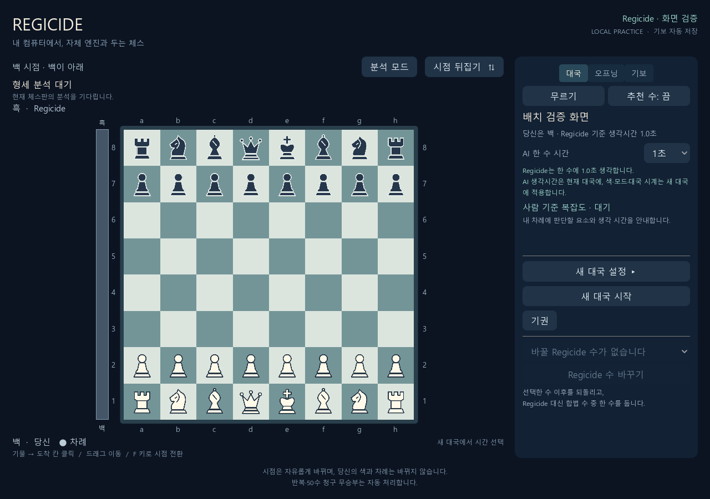
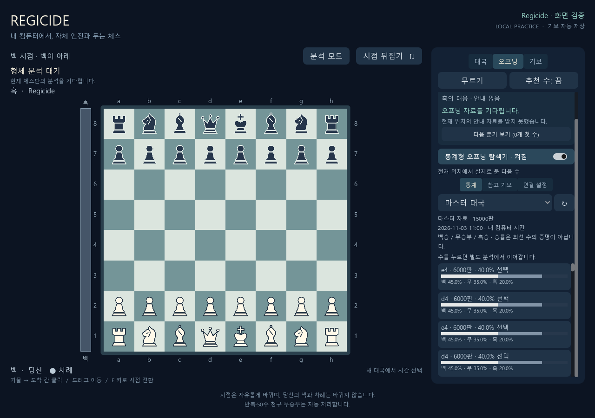
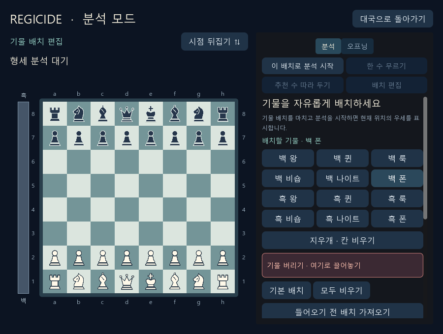

# 탭과 버튼 배치 개선 — 2026-11-03

기준 버전은 `d5538e9`입니다. 사용자가 리체스 연결 성공 후 탐색기의 긴 내용이 다른 기능을 밀어낸다고 보고했고, **탭으로 나누기**를 선택했습니다. 대국·분석·코칭의 자주 쓰는 조작을 정리했습니다.

## 바뀐 배치

- 대국 화면: **대국 / 오프닝 / 기보** 탭을 스크롤 밖에 고정했습니다. 무르기·추천 수도 고정하여 어떤 탭에서도 사용할 수 있습니다.
- 대국 탭: 현재 AI 생각시간을 상단에 두고, 새 대국 설정은 접습니다. 기권은 별도 종료 영역에 둡니다. 브라우저에서 추천을 끄면 설명 카드도 접습니다.
- 오프닝: 수 하나를 한 행으로 줄이고 목록의 높이를 제한합니다. **통계 / 참고 기보 / 연결 설정**을 나눠 긴 연결 설명과 기보 목록을 함께 쌓지 않습니다.
- 기보: 보관함·PGN·코칭·재생을 모았습니다. 복기 복귀와 핸디캡 취소는 다른 탭에 가려지지 않습니다.
- 분석: **분석 / 오프닝** 탭과 분석 시작·추천 수·무르기·배치 편집을 위에 모았습니다. 승격 선택은 필요한 탭으로 자동 이동해 표시합니다.
- 코칭: 색·시간·시작/중단·진행률을 긴 코치 소개보다 위에 두었습니다.

레이아웃 변경은 대국 위치·시계·기보를 바꾸지 않습니다. 연결키 저장 모듈은 수정하지 않았습니다. 숨긴 오프닝 탭과 연결 설정 탭에서는 자동 통계 조회를 멈추며, 다른 탭에서 돌아와도 선택한 자료·필터는 유지합니다.

## 수행한 검증

| 검증 | 실제 결과 |
| --- | --- |
| Godot 레이아웃 | 헤드리스 33개, 네이티브 PNG 8개 포함 41개 검사 통과. 1280×900·900×680, 100행에서도 고정 탭·공통 조작·보드 크기 유지 확인 |
| 탐색기 UI | Godot 28개, 브라우저 12개 통과. 내부 탭·숨김 조회 중단·필터 유지·분기 탐색 검증 |
| 브라우저 고정 탭 | 5개 통과. 활성 패널 하나만 표시, 키보드 전환, 고정 조작, 보관함 연결 검증 |
| 실제 엔진 통합 | 실제 로컬 HTTP·Godot·Regicide를 연결하고 외부 통계만 합성한 검사 14개 통과. 20개 합법 후보, 별도 분석, 원래 대국·저장 파일 보존 확인 |
| 브라우저 직접 조작 | 1280×900·900×680·390×844에서 탭 전환과 실제 별도 분석을 확인. 20행 목록, 가로 넘침 없음, 모바일 탭 높이 44px 확인 |
| 연결 설정 중 실제 조작 | 연결 설정 탭에서 분석 보드를 한 수 진행했을 때 분석 FEN은 바뀌고 탐색기 서버 FEN은 이전 위치에 머무름을 확인. 외부 재조회가 중단됨을 확인 |
| 기존 동작 회귀 | Godot 분석 88·오프닝 51·추천 121·시점/입력 637·시간 39·시계 조정 85·코칭 455개 확인. 브라우저 분석 44·오프닝 12·추천 23·코칭 90·애니메이션 25개 및 시계·시간·모드 검사 통과 |
| HTTP 제공 | 로컬 HTTP 6개 통과. 새 `sidebar_tabs.js` 제공 및 기존 세션 인증 유지 확인 |

브라우저 측정에서 오른쪽 패널은 1280×900에서 약 321×734px, 900×680에서 약 321×514px였습니다. 20행 목록은 각각 약 359px·199px 안에서 스크롤하며 탭·공통 조작은 그 위에 남습니다. 390px 화면에서는 가로 넘침 없이 패널 너비 약 345px, 탭 높이 44px로 표시했습니다.

검증 환경은 Python 3.13.16, Node 24.22.1, Godot 4.7.2 Windows입니다. 실제 Regicide 실행 파일 SHA-256은 `5011da4c5e6ef01c452bd7125e4e22b372d2c9cfb858ed8759057325acb0e6ba`입니다. 엔진의 탐색·평가·경기력을 바꾼 작업은 아닙니다.

아래 화면은 **배치 검증용 통계 자료**를 사용합니다.







## 재현

```powershell
node tests/sidebar_web_tests.js
node tests/opening_explorer_web_tests.js
node tests/web_analysis_tests.js
& $godot --headless --path godot --script res://tests/opening_explorer_layout_tests.gd
.\.venv-tests\Scripts\python.exe tests/opening_explorer_integration_tests.py --binary $binary --godot $godot --fixture-moves 20 --output build/sidebar-layout-verification
```

`$godot`, `$binary`는 각각 설치된 Godot과 Regicide 실행 파일의 절대 경로로 지정합니다. 통합 검사는 임시 대국·연결키 저장소와 합성 외부 응답을 사용합니다. 실제 리체스 인증 성공은 사용자가 보고했으며, 이번 레이아웃 검증에서는 개인 연결키를 사용하지 않았습니다.
