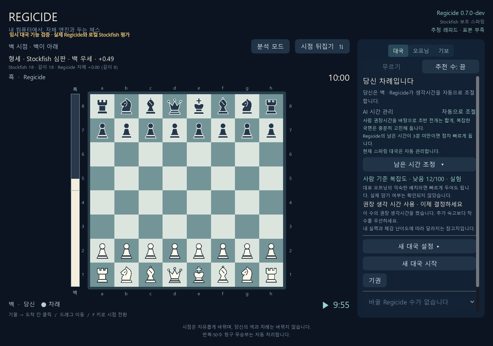

# 별도 로컬 Stockfish 심판 — 기능 검증

2026-11-03, Windows 공유 개발 PC에서 검증했습니다. 작업 기준 커밋은 `307f33ab69a24d2a454b72dab0a8cb2284965008`이며, 최종 실행에 사용한 소스 해시는 증거 JSON에 별도로 기록합니다. 기존 사용자 대국·기보·리체스 토큰은 사용하거나 수정하지 않았습니다. 테스트가 만든 엔진과 임시 서버만 정리합니다.

## 구현 범위

- 실제 Regicide 기준수와 자체 검증된 양보 후보만 Stockfish 심판에 전달합니다. 심판의 자유 탐색 수를 실제 착수로 사용하지 않습니다.
- 심판 후보 비교는 같은 완료 깊이의 Stockfish 점수끼리 수행하고, 착수 후 제한 없는 상대 응수를 재검사합니다. 자체 점수와 심판 점수의 차이를 계산하지 않습니다.
- 현재 위치의 심판 평가와 자체 평가를 독립 채널로 보존합니다. Godot·브라우저는 현재 대국/수정 번호/FEN/차례가 맞는 완료된 정확 평가만 표시합니다.
- 실패·미완성·해시 불일치·취소는 자체 기준수로 복귀합니다. 기존 시계 만료·무르기·20수 균형 회복·50수 전력 전환을 보존합니다.
- 외부 보조 모드와 양 엔진 신원을 JSON·PGN·보관함 재생에 남깁니다. 과거 기보는 기존 동작을 유지합니다.

## 실행 조건

| 항목 | 조건 |
| --- | --- |
| Regicide | `Regicide 0.7.0-dev`, 기존 runtime 바이너리 유지 |
| Regicide SHA256 | `5011da4c5e6ef01c452bd7125e4e22b372d2c9cfb858ed8759057325acb0e6ba` |
| Stockfish | 공식 Stockfish 18, Windows x86-64 generic |
| Stockfish SHA256 | `9bde420202717ce083412027fbfb8c5c935b537591d712be8a8a8bae92f6e8d6` |
| Stockfish 소스 | `cb3d4ee9b47d0c5aae855b12379378ea1439675c` |
| 심판 설정 | Threads=1, Hash=32MiB, Skill Level=20, UCI_LimitStrength=false |
| 기본 형세 분석 | 기동 최대 1.5초 + 분석 500ms, 종료 여유 기본 350ms |
| 기본 후보 검사 | 기동 포함 총 1,500ms, 시계에 따라 축소·생략 |
| 테스트 Python / Node / Godot | 3.13.16 / 24.22.1 / 4.7.2 stable |
| 격리 범위 | 임시 대국·직접 선택한 로컬 바이너리·소유 프로세스만 사용 |

## 자동 검사

신규 Python 검사는 resolver 12개, 심판 26개, 호스트·기보 18개를 통과했습니다. 정상 후보·공통 깊이 미완성·상한/하한 점수·백흑 부호·착수 후 반격·심판 실패·binary 변경·낡은 대국/위치·‘지금 두기’·취소 후 분석 재시작 방지·기동 시간 분리·시계별 예산 축소·양색 50수 전환·일반 모드 비활성·출처 보존을 검사했습니다.

관련 Python 회귀 23묶음을 통과했습니다. 최초 묶음 실행의 393개 중 2개는 기존 환경 조건으로 건너뛰었고, 이후 추가한 기동·시계 경계 검사까지 심판 26개·호스트 18개를 다시 통과했습니다. 기존 `human_play_tests.py`는 실제 Regicide로 별도 26개를 통과했고, 그 실행에 포함된 평가 상태 검사 30개도 통과했습니다. 중복 실행한 평가 검사를 별도 신규 기능 수로 세지 않습니다.

브라우저 후보·평가 검사 29개와 탭 5개, 시계·모드 회귀를 통과했습니다. Godot 심판 표시 검사는 50개, 렌더 저장까지 포함하면 52개를 통과했습니다. 기존 평가 막대 58개·분석 88개도 통과했습니다. 화면 자동 검증과 테스트용 렌더이며 사람이 대국한 결과로 해석하지 않습니다.

## 실제 엔진 검사의 발견과 수정

첫 실제 실행에서는 generic Stockfish 초기화 약 0.8초가 형세 분석 500ms를 소모해 조회가 실패했습니다. 형세 조회의 기동 상한과 분석 예산을 분리했고, 기동 시간이 분석 시간을 줄이지 않는 회귀 검사를 추가했습니다. 동기 후보 검사는 시계 보호를 위해 기동 비용을 계속 총 예산에 포함합니다. 취소한 후보 검사 뒤 분석이 되살아나는 경쟁 조건도 독립 리뷰에서 발견해 세대·위치가 유지될 때만 재개하도록 수정했습니다.

모듈의 실제 Stockfish 검증은 작성한 고정 위치로 백/흑 차례의 백 기준 점수, 제공 후보 허용, 명백한 퀸 손실 후보 거부, 취소와 종료를 확인했습니다. 이 위치의 후보는 검증용으로 직접 제공한 수이며 Regicide가 검색한 결과라고 주장하지 않습니다. 호스트 검증과 구분합니다. 공유 PC의 단발 관측이며 속도 벤치마크가 아닙니다.

최종 실제 모듈 검사는 기본 1,500ms 예산의 7건 모두 통과했습니다. 허용 분기용 FEN `3rk3/7p/8/8/3Q4/8/P7/4K3 w - - 0 1`에서 직접 제공한 `Qe5`는 +520cp, `Qxd8`은 +4cp(공통 깊이 19)였고, 목표 +20cp에 가까운 `Qxd8`을 허용했습니다. 착수 후 `Kxd8` 재검사는 0cp·깊이 44, 총 시간은 약 1,495ms였습니다. 초기 위치의 `a3/e4`는 2,000ms 검사에서 e4를 허용했지만 1,500ms에서는 목표에 더 가까운 a3 기준수를 유지했습니다. 두 관측 모두 남겼고, 항상 양보 수가 선택된다는 주장으로 쓰지 않습니다.

초기 기동 중 취소는 UCI 연결이 반환될 때까지 지연될 수 있습니다. 이번 50ms 취소 요청의 함수 반환은 약 818ms였으며 기동 상한은 유한합니다. 새 위치에 취소된 결과가 적용되지는 않습니다. 최종 모듈 검사에서 소유 Stockfish 7개가 모두 종료됐습니다.

실제 Regicide + Stockfish + 인증된 로컬 HTTP + 렌더링한 Godot의 통합 검사도 통과했습니다. 백·흑의 합법 착수, 현재 위치의 심판 점수와 자체 채널 보존, 무르기 세대 변경, PGN·보관함의 양 엔진 SHA 분리, 일반 모드에서 외부 평가 제거, 소유 엔진 프로세스 20개 종료를 확인했습니다. 네이티브 실제 연결 검사는 9개를 통과했고 아래 화면을 저장했습니다. 이 짧은 수순의 3회 Regicide 착수는 모두 원래 기준수와 자체 후보가 같아 `baseline_only`였습니다. 실제 호스트 실행에서 양보가 선택됐다는 근거로 사용하지 않습니다.



[조건·완료 검사·소스 해시·실제 점수·프로세스 종료 증거](evidence.json)를 함께 보관합니다. 전체 작업 로그는 로컬 `build/sparring-referee-verification/`에 있으며, 최초 실패와 수정 전 관측도 보존했습니다.

## 재현

추가 설치 없이 실행하는 단위 검사:

```powershell
.venv-tests\Scripts\python.exe tests/referee_engine_tests.py
.venv-tests\Scripts\python.exe tests/sparring_referee_tests.py
.venv-tests\Scripts\python.exe tests/sparring_referee_host_tests.py
```

실제 엔진·HTTP·선택적 네이티브 화면 검증:

```powershell
.venv-tests\Scripts\python.exe tests/sparring_referee_native_smoke.py --output build/sparring-referee-verification/new-module-run
.venv-tests\Scripts\python.exe tests/sparring_referee_integration.py --binary <Regicide실행파일> --referee-engine <Stockfish실행파일> --godot <Godot실행파일> --rendered --output build/sparring-referee-verification/new-host-run
```

새 출력 폴더를 지정합니다. 실제 검증은 로컬 엔진 실행이 필요하며 CI는 Stockfish를 다운로드하지 않고 가짜 UCI 경계 검사와 UI 검사를 수행합니다.

## 해석 범위

Regicide의 C++ 소스·바이너리·평가 함수·학습 데이터는 이번 변경으로 바꾸지 않았습니다. Stockfish를 추가한 스파링의 기능과 출처 보존을 검사했습니다. **독립 Regicide의 Elo, 접전 유지율, 인간 체감 난이도, 모든 전술의 안전성은 검증하지 않았습니다.** 완주 대국과 기력 비교 실험은 이번 실행 범위에 포함하지 않았습니다.
