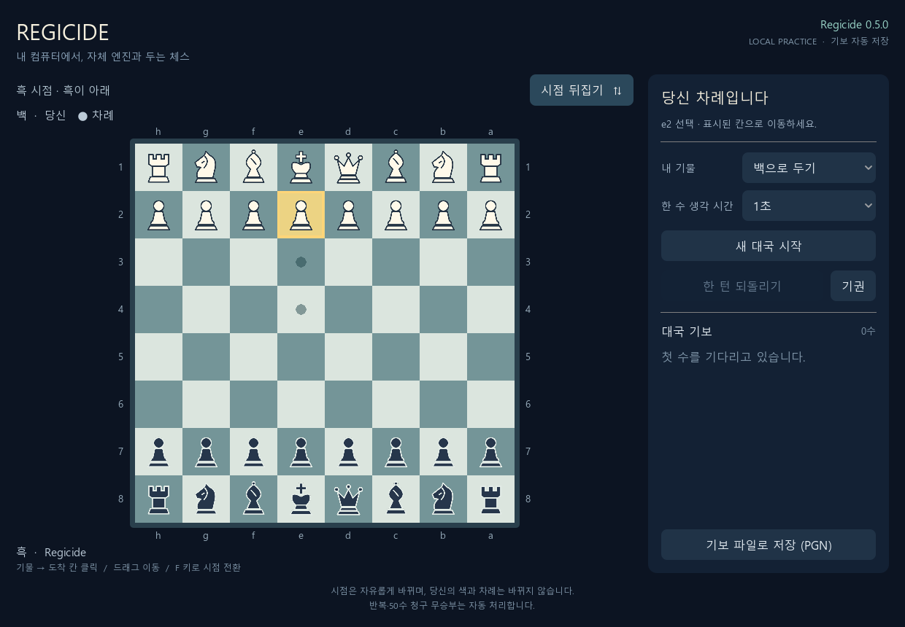
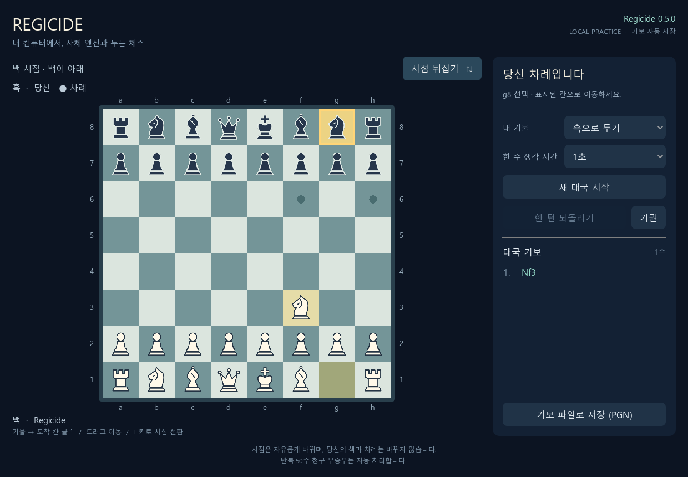
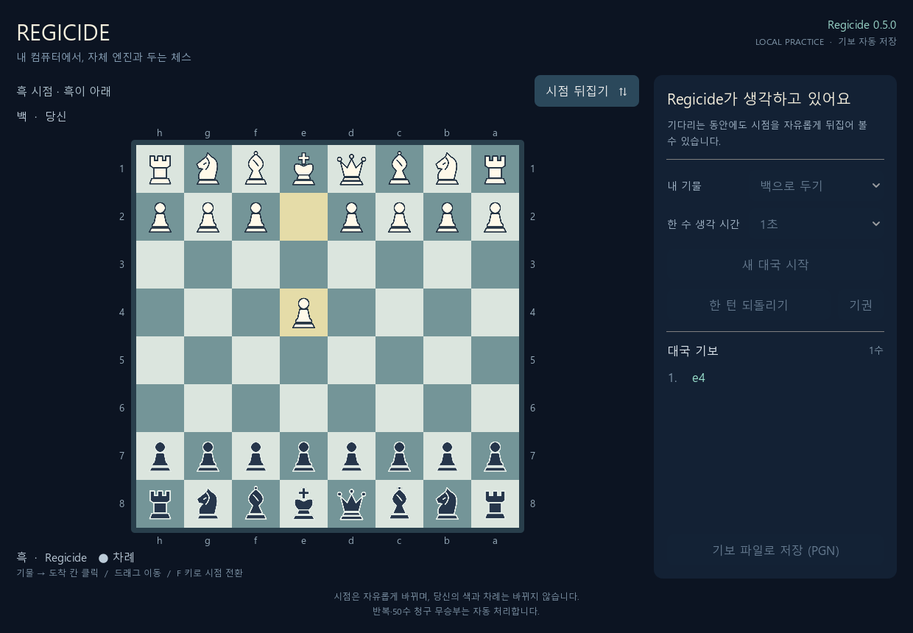

# Godot 대국 화면과 자유로운 시점 전환 검증

실행일: 2026-10-17 (Asia/Seoul)

## 변경과 기준

기준은 브라우저 대국 버전 `6c864273ea725ae52277abbd779537c2cd8f139d`다. `feat/godot-play`에서 Godot 대국 화면·실행기·검증을 추가했다. C++ 규칙·탐색·평가 코드는 변경하지 않았다. 실행 엔진은 기존 **Regicide 0.5.0**, SHA-256은 `cf4162a083d81756aa282595005ae0c9f06bebb4a15b098e0afabae5fb4bf7b9`다. 화면의 변경을 엔진 경기력 개선으로 해석하지 않는다.

시점은 Godot 내부의 `view_from_white` 값으로 관리한다. 버튼/F 키는 이 값만 바꾸고, 칸 좌표와 클릭·드래그 대응을 함께 뒤집는다. 플레이어 색·서버의 기물 배치·수순·차례·revision에는 영향을 주지 않는다. HTTP 요청 중, 선택·승격·종료 상태에서도 뒤집을 수 있다. 새 대국·되돌리기·서버 응답도 사용자가 고른 시점을 유지한다.

Godot은 화면과 입력을 맡고 기존 Python 대국 관리기를 이용한다. 실제 수는 C++ Regicide가 고른다. 별도 빈 포트에 새 대국을 시작하므로 이미 열려 있던 브라우저 대국에는 접근하거나 상태를 바꾸지 않았다.

## 실행 환경과 재현

- Windows 11, Godot `4.7.2.stable.official.ed1daf0bf`, OpenGL Compatibility, NVIDIA GeForce RTX 5070 Ti Laptop GPU.
- 기존 MSVC Release 엔진 실행 파일과 Python 3.13.16, 검증 라이브러리 `chess==1.11.2`.
- 실제 엔진 연결 검사는 엔진 한 수에 **1,000ms**, 기존 기본 Move Overhead 20ms로 실행했다. 실제 탐색 세 번은 약 0.985~0.987초였다. 이는 속도 비교 실험이 아니다.
- CI는 Ubuntu·Windows에서 기존 전체 검사와 새 헤드리스 Godot 검사를 실행한다. Godot은 [공식 4.7.2 배포](https://github.com/godotengine/godot-builds/releases/tag/4.7.2-stable)의 아카이브와 SHA-256을 고정했다. 설치 코드는 `scripts/install_test_godot.ps1`에 있다.

재현 명령은 [Godot 사용 안내](../GODOT_PLAY.md)에 정리했다. `--rendered`는 실제 Godot 창과 OpenGL 렌더링으로 같은 입력 검사를 수행한다. 입력은 Godot Viewport에 합성한 자동 입력이며 **사람이 마우스로 수동 대국한 검증은 아니다**.

## 확인 결과

| 검사 | 실제 결과 |
| --- | --- |
| 기존 C++ 규칙·탐색·평가·보드 상태·전이표 | CTest 5/5 통과 |
| 외부 기준과 합법 수·상태·종료 판정 교차 검증 | 2,997개 통과, seed=20261017 |
| 기존 사람 대국 모델·HTTP·특수 규칙·양색 실제 엔진 | 25개 통과 |
| 실제 프로세스의 데스크톱 연결·인증·기존 브라우저 호환 | 3개 통과 |
| Godot 전체 좌표·역변환·라벨·시점·실제 장면 입력 | 헤드리스·실제 렌더링 각각 637개, 실패 0 |
| 실제 Regicide 응수·양색·탐색 중 뒤집기·되돌리기·기권 | 헤드리스 75개 / 실제 렌더링 81개, 실패 0; 차이는 PNG 저장 검사 6개 |
| 편집기 캐시 없는 새 프로젝트의 직접 실행 | 최초 실행 성공, 파서·스크립트 오류 없음 |
| 소유 대국 관리기 종료 | 대기 중·실제 탐색 중·지연된 착수 응답 중의 3개 사례 통과; 저장 기보도 재검증 |
| Windows 실행기 | 독립 관리기 시작, 초기 합법 수 20개, e2e4·실제 엔진 응수, 인증 값 콘솔 비노출, 정상 종료 확인 |

전체 64칸을 두 시점에서 확인했다. 클릭뿐 아니라 선택 전·후 드래그, 캐슬링·앙파상·4종 승격, 승격 선택 중 뒤집기와 잘못된 칸 입력을 검사했다. 실제 장면의 버튼·F 키 입력이 화면 모델에 전달되는 것도 확인했다.

실제 HTTP 기록에는 의도한 `/api/move`, `/api/engine`, `/api/undo`, `/api/new`, `/api/resign`만 존재한다. 여러 번 뒤집어도 수를 생성하거나 추가 요청을 보내지 않았다. 매 응수의 합법성과 저장 PGN·JSON의 전체 수순·최종 FEN을 외부 라이브러리로 독립 재생했다. 기록에는 인증 토큰을 저장하지 않았다.

검증 중 Godot의 JSON 숫자가 실수로 읽혀 서버의 정수 revision 검사를 통과하지 못하는 문제를 발견했다. 모든 변경 요청에서 정수로 보내도록 수정하고 기존 서버 검증은 유지했다. 편집기 캐시 없이 처음 실행할 때 전역 타입을 못 찾는 문제도 명시적인 `preload` 타입으로 수정했다. 종료 도중 진행 중인 이동을 마친 뒤 최신 revision으로 관리기를 닫도록 했다.

검사 로그·공개 HTTP 기록·화면은 [증거 폴더](../checks/2026-10-17-godot/)에 보관한다. 화면은 1240×860의 실제 네이티브 렌더링이다.

### 내가 백인 대국을 흑 시점에서 관찰

e2 폰의 선택과 e3·e4 도착 후보를 유지한 채 흑이 아래로 보인다.

### 내가 흑인 대국을 백 시점에서 관찰

오른쪽 설정은 흑, 아래 기물은 백이며 선택한 흑 나이트의 합법 이동 칸이 표시된다.

### 엔진이 생각하는 중에도 전환 가능

이동·설정 버튼은 응수를 기다리는 동안 비활성화되지만 시점 버튼은 계속 동작한다.

## 범위와 남은 확인

현재 결과는 화면·입력·로컬 엔진 연결의 검증이다. 새 엔진 성능 비교 대국은 수행하지 않았다. 기존 브라우저 버전과 기보·규칙 처리 정책을 공유하며, Python의 복잡한 죽은 포지션 판정 범위와 실제 엔진의 강도는 기존 문서의 한계를 따른다. Godot 프로젝트와 Windows 런처를 제공하며 독립 실행 파일 내보내기·모바일·웹 배포는 이번 범위에 포함하지 않았다.
