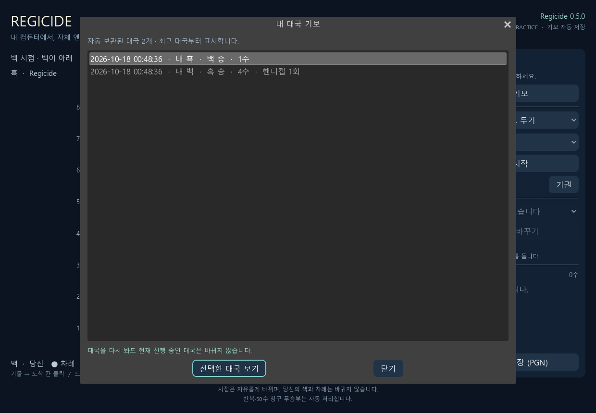
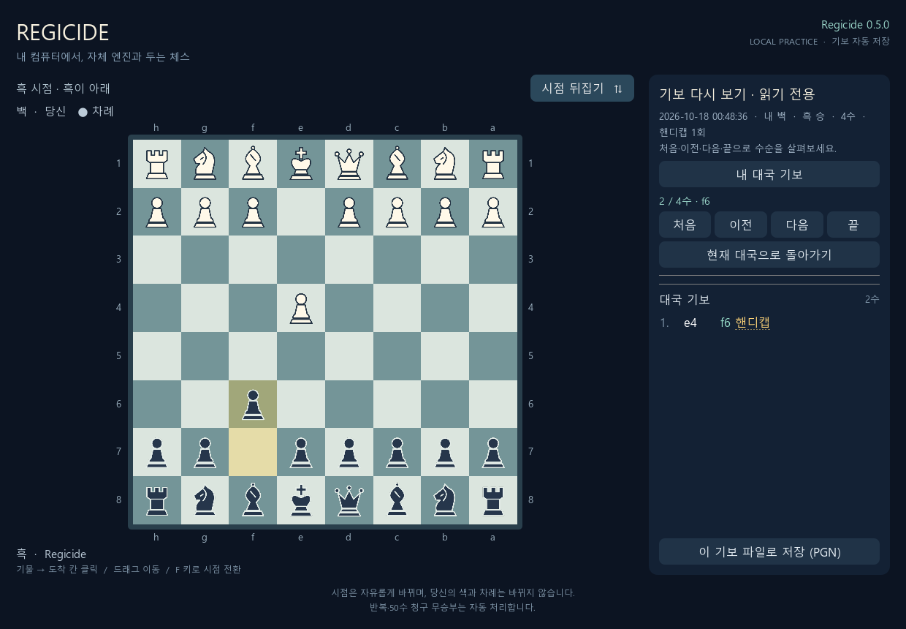
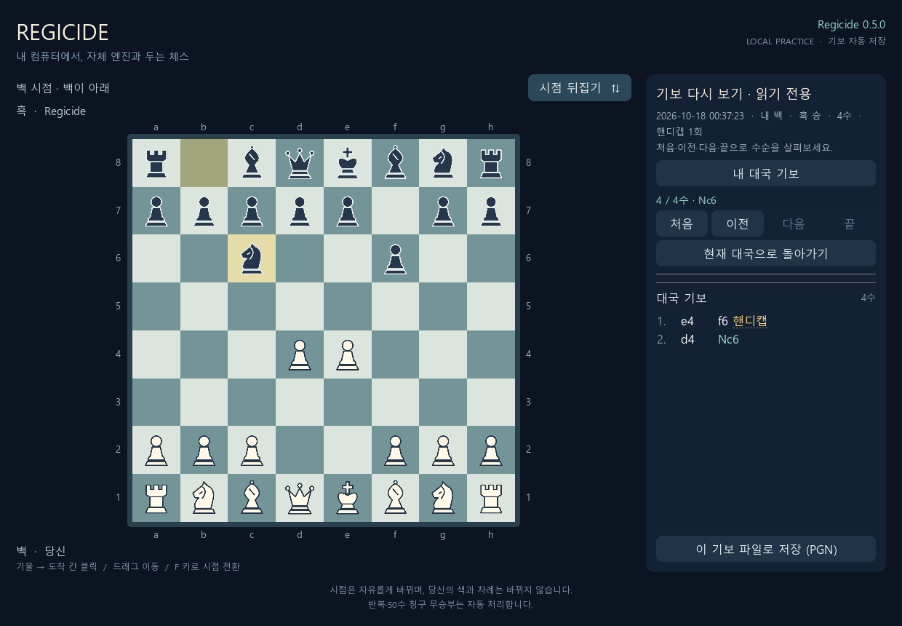

# 사용자 대국 보관함과 기보 재생 검증

실행일: 2026-10-18 (Asia/Seoul). 기준 커밋: `44aa528f6f9600b1b1153f4cc27c54819b81ee57`. 구현 브랜치: `feat/game-library`.

## 저장과 재생

기존에는 대국별 PGN·JSON이 `build/human-games/`에 저장됐지만, 프로그램에서 지난 대국을 고르거나 재생할 수 없었다. 새 버전은 Windows의 실제 문서 폴더 `Regicide/games/`를 사용하며 새 대국·재실행마다 기보를 누적한다. 저장소나 빌드 폴더를 옮겨도 개인 기록이 같은 보관함에 남는다. 명시적인 `--save-dir`은 별도 보관함을 지정한다.

매 수의 자동 저장과 고유 대국 번호를 유지하고, 시작·갱신·종료 시각과 완료/미완료/오류 상태를 추가했다. 새 대국을 시작하거나 정상 종료하면 이전 미완료 기보는 결과 `*`로 남는다. 완료 시각은 처음 결과가 정해졌을 때 보존하고 무르기로 재개하면 해제한다. 핸디캡 취소는 원래 갱신·종료 시각도 복원한다. 핸디캡 미리보기 중 종료는 기존 파일의 바이트 보존 원칙을 유지하며, 다음 실행에서는 현재 대국이 아닌 기록을 미완료로 분류한다.

**내 대국 기보**는 날짜·내 색·결과·착수 수·핸디캡 횟수를 최근 순으로 보여준다. 시작 배치부터 처음·이전·다음·끝으로 재생하고 백·흑 시점을 전환할 수 있다. 재생 중에는 대국 변경 조작을 숨기고 직접 호출도 차단한다. 선택 기보의 전체 PGN을 저장할 수 있으며, 현재 대국으로 복귀하면 원래 선택 상태와 판이 유지된다.

JSON의 초기 위치와 전체 UCI 수순을 합법적으로 재생해 각 화면·SAN·PGN을 만든다. PGN 파일이 없어도 JSON에서 복원한다. 전체 수 목록은 한 번만 전송하고 각 프레임에는 판과 차례 등을 담아 수순 중복 전송을 피한다. 파일 변경 시 검증 캐시를 갱신하며, 손상된 파일은 원본을 보존한 채 정상 목록과 분리한다. 읽기 전용 API에도 기존 로컬 인증을 적용하고 경로 이탈·심볼릭 링크·잘못된 대국 번호·파일 크기와 수순 길이를 제한한다.

이전 폴더 가져오기는 원본을 바꾸지 않는다. 같은 기록은 중복 생성하지 않고, 동일 번호의 다른 기록은 별도로 보존한다. 사용하던 두 개발 폴더에서 실제 대국 **12개**를 가져왔으며 오류 0개, 반복 가져오기의 추가 생성 0개, 원본 해시 일치를 확인했다. 빈 시작 화면은 목록과 가져오기에서 제외했다. 개인 기보는 로컬 문서 폴더에 보관하며 이 검증 문서의 공개 증거에는 포함하지 않는다.

## 실행 환경과 결과

Windows 11, Godot `4.7.2.stable.official.ed1daf0bf`, OpenGL Compatibility/NVIDIA GeForce RTX 5070 Ti Laptop GPU, Python 3.13.16, `chess==1.11.2`로 실행했다. C++ 규칙·탐색·평가는 변경하지 않았다. 엔진은 기존 Regicide 0.5.0, SHA-256 `cf4162a083d81756aa282595005ae0c9f06bebb4a15b098e0afabae5fb4bf7b9`다.

| 검사 | 실제 결과 |
| --- | --- |
| 기존 C++ 규칙·탐색·평가·상태·전이표 | CTest 5/5 통과 |
| 외부 기준과 규칙 교차 검증 | 2,997개 통과, seed=20261017 |
| 기존 사람 대국·HTTP·실제 엔진 | 25개 통과 |
| 기존 무르기·핸디캡 | 19개 통과 |
| 데스크톱 연결·기존 브라우저 호환 | 3개 통과 |
| 새 보관·재실행·가져오기·API·오류 검사 | Windows 20개 중 19개 통과·권한 제한 1개 건너뜀, WSL Linux 20개 모두 통과 |
| 기존 Godot 시점·입력 | 637개 통과 |
| 기존 Godot 실제 엔진·종료 | 75개 및 종료 3사례 통과 |
| 기존 Godot 핸디캡·양색 엔진 연결 | 헤드리스 53개 통과 |
| 새 Godot 보관함·재생·현재 대국 복귀 | 헤드리스 76개 / 네이티브 렌더링 82개 통과; 차이는 PNG 저장 검사 6개 |

새 보관 검사에는 양색·재실행 후 누적, 완료·미완료·오류, 메이트·무승부, 완료 후 무르기, 핸디캡 표시·미리보기 보존, 실제 엔진 기보 재생, 손상 기록 격리, 인증·경로 이탈 거부, PGN 복원, 중복 없는 가져오기와 충돌 보존, 한국 시간 오프셋의 UTC 정규화를 포함했다. 첫 Linux CI에서 심볼릭 링크 검사의 빈 기보 수 기대값 오류가 드러나 실제로 수를 둔 기보로 검사하도록 고쳤다. 보관함의 빈 기보 제외·링크 거부 동작은 유지했다. 수정 후 WSL Linux에서 실제 Linux 엔진으로 20개 모두 통과했으며, 양쪽 CI에도 같은 검사를 유지한다.

실제 C++ 엔진으로 양색 대국·핸디캡·기권 기록을 만들고 대국 관리기를 재시작한 후, Godot에서 해당 기보를 열었다. 과거 판은 별도로 재생한 기준과 일치했고, 기보 열람 중 요청은 GET뿐이었다. 기존 저장 파일과 진행 중 대국은 유지됐다. 복귀 후 사용자의 수와 실제 엔진 응수를 진행했을 때만 `/api/move`, `/api/engine`이 발생했다. 준비 대국은 수당 100ms, 복귀 후 응수는 기본 1,000ms로 실행했으며 경기력 비교는 하지 않았다.

Godot 화면 검사는 실제 OpenGL 창의 장면 조작·합성 입력으로 수행했다. 사람의 수동 대국 검증과 구분한다. 현재 대국 조작부가 재생 중 숨겨지는지, 선택 기보 PGN 저장 버튼이 화면 안에 있는지, 복귀 후 조작부가 복원되는지도 확인했다. 임시 폴더의 합성 대국·API·화면만 [검증 증거](../checks/2026-10-18-game-library/)에 보관했다.

재현 명령과 저장 위치는 [Godot 사용 안내](../GODOT_PLAY.md)에 정리했다.
