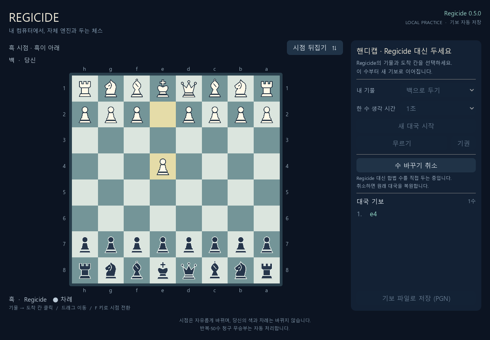
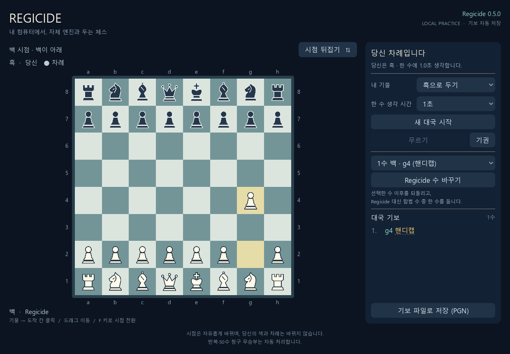

# 무르기와 사용자 지정 핸디캡 검증

실행일: 2026-10-17~18 (Asia/Seoul). 기준 버전: Godot 대국 커밋 `7d9d870e4c7c42faaa746a326b12d41903fe8541`. 구현 브랜치: `feat/handicap-play`.

## 바뀐 동작

**무르기**는 내 수와 Regicide 응수를 한 턴씩 되돌려 다시 내 차례로 돌아간다. 여러 번 사용할 수 있다. 내가 둔 수 자체로 대국이 끝나 응수가 없는 경우에도 그 수를 무를 수 있도록 보완했다. 내가 흑일 때 엔진의 첫 수는 유지한다.

**Regicide 수 바꾸기**는 기보에서 선택한 엔진 수 직전으로 돌아가 사용자에게 합법 수를 직접 지정하게 한다. 가장 최근 응수뿐 아니라 과거 응수·백 엔진의 첫 수도 고를 수 있다. 지정하면 선택한 수 이후의 기존 수순을 버리고 새 수순으로 이어 간다. 지정 직후는 사람 차례이며, 사람이 응수한 다음 Regicide는 수정된 전체 수순으로 탐색한다. 사용자가 지정한 수를 엔진의 선택으로 기록하지 않는다.

편집 중에는 자동 탐색·일반 수 제출을 막는다. 무르기·새 대국·기권도 지정 완료 또는 취소 후에 가능하다. **수 바꾸기 취소**는 원래 전체 수순·결과·오류·이전 핸디캡 표시를 복원한다. 백·흑 시점 전환·클릭·드래그·승격 선택은 핸디캡 중에도 사용할 수 있다.

## 이력·저장·탐색 처리

- FEN만으로 재시작하지 않는다. `board.copy(stack=True)`와 수 되돌리기로 반복·캐슬링·앙파상·50수 이력을 보존한다.
- 변경 요청은 기존 인증과 정수 revision 검사를 적용한다. 같은 revision의 동시 강제 수는 하나만 반영한다.
- 교체를 미리 보는 동안 원래 PGN·JSON 자동 저장 파일을 덮어쓰지 않는다. 그 상태에서 창을 닫으면 원래 기보가 남는다. 미리보기 중 PGN API도 원래 전체 기보를 제공한다.
- 확정한 수에는 화면의 **핸디캡**, PGN의 `User-forced Regicide move (handicap)` 주석과 `HandicapMoves` 개수, JSON의 `forced: true`를 남긴다. `actor`는 둔 색에 해당하는 엔진으로 유지하되 수의 지정 주체를 별도로 표시한다.
- JSON의 `handicap_events`에 대상 수·교체한 수·삭제된 이전 후속 수순·이전 결과를 남긴다. 무르기로 제거된 강제 수 표시는 현재 수순에서 제거한다.
- 교체 확정·무르기 후 새 게임 토큰으로 다음 UCI 탐색을 시작한다. 기존 C++의 `ucinewgame` 처리로 탐색 상태를 초기화하고 전체 유효 수순을 전달한다. 엔진 오류 후 재개할 때는 연결도 다시 준비한다.

C++ 규칙·탐색·평가는 변경하지 않았다. 실제 엔진은 Regicide 0.5.0이며 SHA-256은 `cf4162a083d81756aa282595005ae0c9f06bebb4a15b098e0afabae5fb4bf7b9`다.

## 실제 검증 결과

Windows 11, Godot `4.7.2.stable.official.ed1daf0bf`, OpenGL Compatibility/NVIDIA GeForce RTX 5070 Ti Laptop GPU, Python 3.13.16, `chess==1.11.2`, 기존 MSVC Release 실행 파일로 검사했다.

| 검사 | 결과 |
| --- | --- |
| 기존 C++ 규칙·탐색·평가·상태·전이표 | CTest 5/5 통과 |
| 외부 규칙 기준과 비교 | 2,997개 통과, seed=20261017 |
| 기존 사람 대국·HTTP·실제 양색 엔진 | 25개 통과 |
| 새 핸디캡 모델·HTTP·실제 엔진 회귀 검사 | 19개 통과 |
| 기존 Godot 좌표·시점·클릭·드래그·특수 수 | 637개 통과 |
| 기존 Godot 실제 엔진 연결·뒤집기 | 헤드리스 75개 통과; 최초 실행·종료 3상태 검사도 통과 |
| 새 Godot 핸디캡 조작과 실제 엔진 연결 | 헤드리스 53개 / 네이티브 렌더링 57개 통과; 차이는 화면 저장 검사 4개 |

새 모델 검사는 다음을 포함한다: 이전 수 선택·불법 대상·중첩 편집 거부, 정수가 아닌/오래된 revision 거부, 불법 이동·체크 방치 거부, 캐슬링·앙파상·4종 승격, 반복·50수 무승부 이력, 원래 파일 보존과 취소, PGN·JSON 지정 주체 기록, 무르기 후 표시 정리, 첫 수 메이트 무르기, 엔진 오류의 복원·재연결, HTTP 인증과 동시 요청.

실제 Godot 장면에서는 버튼·목록·체스판의 입력으로 양색 대국과 뒤집힌 시점에서 수 교체, 취소, 무르기, 과거 수 재교체를 수행했다. C++ 엔진에 전달된 탐색 입력도 기록했다.

- 내가 백: `e2e4` 뒤의 실제 응수를 `f7f6`로 교체하고 `d2d4`로 응수. 다음 실제 엔진 탐색의 전체 이력이 정확히 **`e2e4 f7f6 d2d4`**였으며 버린 응수는 포함되지 않았다.
- 내가 흑: 엔진의 백 첫 수를 `f2f3`로 교체하고 `e7e5`로 응수. 다음 탐색 이력은 정확히 **`f2f3 e7e5`**였다. 이후 취소 복원과 과거 첫 수를 `g2g4`로 다시 교체하는 동작도 확인했다.
- Godot 실제 엔진 호출 4회는 각 1,000ms를 요청했다. 모델의 별도 실제 엔진 검사는 수당 100ms였다. 이는 비용·경기력 비교 실험이 아니다.
- 저장 PGN·JSON의 전체 수순과 최종 FEN을 외부 라이브러리로 독립 재생했다. 공개 HTTP·탐색 기록에는 인증 값을 넣지 않았다.

실제 네이티브 창의 입력은 **Godot Viewport 합성 입력에 의한 자동 검증**이다. 사람이 마우스로 대국한 결과와 구분한다. [로그·HTTP·탐색 입력·화면 증거](../checks/2026-10-18-handicap/)와 [사용법·재현 명령](../GODOT_PLAY.md)에 근거를 남긴다. 기존에 사용자가 열어 둔 대국은 조작하지 않았다.

Ubuntu·Windows CI에 기존 검사와 새 모델·Godot 핸디캡 검사를 함께 추가했다. 이번 기능은 연습 조작을 위한 것으로, 엔진 강도 개선이나 공식 대국 성적으로 해석하지 않는다.
